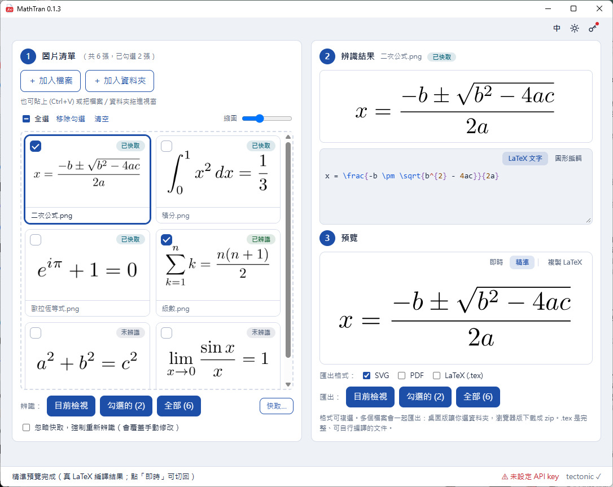
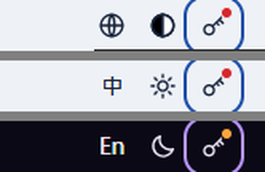
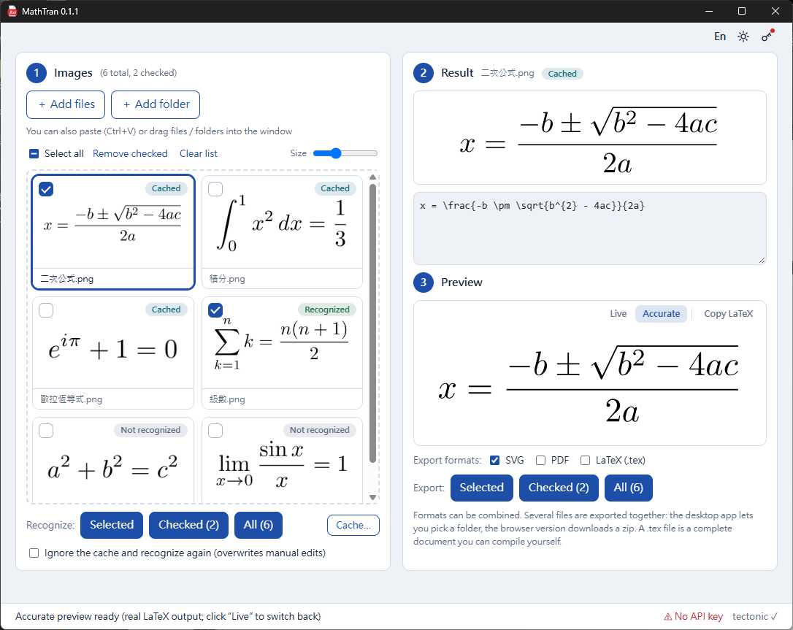
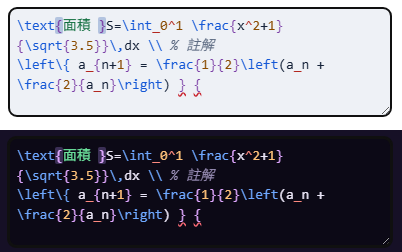
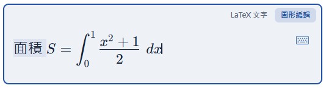
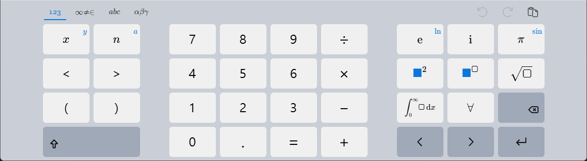

<p align="center"></p>

# MathTran

**Math formula in an image → LaTeX → preview → export SVG / PDF**

🌐 English ｜ [繁體中文](https://github.com/codemee/mathtran/blob/main/README.md) ｜ Technical docs: [Architecture & design (English)](https://github.com/codemee/mathtran/blob/main/docs/en/architecture.md)



## What it does

| Step | Description |
|---|---|
| ① Add images | **Work on many at once**: paste (Ctrl+V), drag in files or a whole folder, or use "Add files" / "Add folder" — at any time. Duplicates are skipped automatically. PNG / JPEG / WebP / GIF |
| ② Recognize as LaTeX | A Claude vision model turns each image into LaTeX; recognize just the **current** one (the one shown on the right), the **checked** ones, or **all**. Results are **cached**, so nothing is recognized twice |
| ③ View and edit | Click an image on the left and its LaTeX appears on the right, ready to edit (edits are cached too) |
| ④ Preview | Instant "live" preview (works offline), switchable to an "accurate" preview compiled with real LaTeX; formulas that are too long shrink automatically so the **whole formula stays visible** |
| ⑤ Export | Export **SVG** (text converted to outlines), **PDF** and **LaTeX (.tex)** — **formats are multi-select** — again for the **current**, **checked** or **all** images |

Three ways to use it, all sharing one core:

| Mode | Command | Best for |
|---|---|---|
| Desktop window | `mathtran gui` | Everyday use; exports open a "Save as" dialog |
| Browser | `mathtran serve` | Working in a browser tab |
| Command line | `mathtran ocr / render / convert` | Batch jobs on folders, scripting |

## Installation

There are two ways; pick one:

| Way | Best for | What you install yourself |
|---|---|---|
| **A. Download a package** (Windows ZIP / macOS DMG) | Most people who just want the window app | Nothing (Tectonic is bundled) |
| **B. `uv tool install mathtran`** | Command-line users, or anyone who already has Python | Tectonic |

### A. Download a package

Get it from [Releases](https://github.com/codemee/mathtran/releases/latest):

| System | File | How to use |
|---|---|---|
| Windows 10 / 11 (x64) | `MathTran-<version>-windows-x64.zip` | Unzip and run `MathTran.exe` |
| macOS (Apple Silicon, M1 and later) | `MathTran-<version>-macos-arm64.dmg` | Open the DMG and drag MathTran into Applications |

- Only an **Apple Silicon** (M1 and later) macOS package is provided; **on an Intel Mac use way B** (`uv tool install mathtran`)
- The packages are **not code-signed** (the author has no paid developer certificate):
  - If Windows shows a SmartScreen warning, click "More info" → "Run anyway"
  - On macOS, the first time **right-click the app → "Open"**, or go to System Settings → Privacy & Security and click "Open Anyway"
- `SHA256SUMS.txt` next to the files lets you verify the download
- The macOS builds are produced and smoke-tested in CI only; **the author has not tried them on real Mac hardware**. Please report problems in [Issues](https://github.com/codemee/mathtran/issues)
- The packaged app has limited command-line abilities (it is a windowed program with no console); use way B for the command line

### B. Install with uv (PyPI)

Requirements:

| Item | Notes |
|---|---|
| [uv](https://docs.astral.sh/uv/) | Prepares Python (3.12+) for you |
| Tectonic | Compiles LaTeX (needed for export and accurate preview) |

Steps:

1. Install Tectonic:
   - Windows: `scoop install tectonic`
   - macOS / Linux: `brew install tectonic`
2. Install MathTran:
   ```bash
   uv tool install mathtran
   ```
   Update later with `uv tool upgrade mathtran`
3. Launch: `mathtran gui` (or `mathtran serve` to use it in a browser)

### Setting the API key

Image recognition needs an Anthropic API key (not needed for LaTeX → SVG / PDF / .tex only). Any one of:

- The **key icon** in the toolbar at the top right of the desktop / web UI (a red dot on it means no key is set yet)
- Command: `mathtran config --api-key <YOUR_KEY>`
- Environment variable: `ANTHROPIC_API_KEY`

> ⚠️ **The first compile is slow**: Tectonic downloads LaTeX packages over the network (a few minutes). Later runs are fast.
> ⚠️ Formulas with Chinese need a CJK font on the system (Windows ships "Microsoft JhengHei", macOS ships "PingFang TC").
> ⚠️ The author has only tested on **Windows 11**; macOS / Linux should work but are unverified.
## Usage

### Toolbar: language, theme, API key

The toolbar at the top right has three icon buttons. Language and theme are **three-state buttons**: each click moves to the next state.



From left to right: language, theme, API key. The three rows show three combinations of states as they actually look:

| Button | States it cycles through (icon) | Notes |
|---|---|---|
| Language | globe → "中" → "En" | Follow system → Traditional Chinese → English. "Follow system" uses Traditional Chinese on a Chinese system and English otherwise |
| Theme | half-black-half-white circle → sun → moon | Follow system → light → dark. "Follow system" follows the operating system's dark / light mode |
| API key | key | Opens the settings dialog to enter the API key and **choose the recognition model**; **a red dot on the key means no key is set yet** |

Hovering a button shows its current state, and the status bar confirms the change (for example "Language: English").

**Two color schemes** (colors only — no logos or artwork are used; the names and trademarks belong to their respective owners and this project is not affiliated with them):

| Theme | Inspired by | Colors |
|---|---|---|
| Light | Gundam RX-78-2 | White body as the base, Gundam blue as the main color, with red and yellow accents (yellow is used only for the step-number circles: blue on yellow) |
| Dark | Neon Genesis Evangelion | Deep purple-black base, Unit-01 purple as the main color, with neon-green and orange accents (the step-number circles are neon green with dark digits; the "not set yet" dot on the key is orange) |

Everything is drawn in flat, solid colors — there are no gradients. The text contrast of both schemes is checked (normal text is never below 4.5:1).

| Light (Gundam RX-78-2) | Dark (Evangelion) |
|---|---|
|  |  |

**Language** applies to the whole window, including the status bar and error messages (back-end messages such as recognition or compile failures use the same language). Command-line result messages use, in order, the `MATHTRAN_LANG` environment variable, the language you chose in the UI, then the system language; `--help` text is currently Chinese only.



**Your choices are remembered**: language, theme, thumbnail size and export formats are stored in `~/.mathtran/config.json`, shared by the desktop and web versions, and survive restarts.

#### Recognition model

Besides the API key, the dialog behind the key icon has a **Recognition model** drop-down:

| Option | Note |
|---|---|
| `claude-haiku-5-5` | light, fast |
| `claude-sonnet-5-5` | **default** |
| `claude-opus-5-5` | stronger |
| `claude-fable-5-2` | strongest |
| Custom model ID… | type another model ID (it must accept image input, e.g. a newly released model) |

- Clear the custom field and save = back to the default
- After changing the model, **images that were already recognized keep their cached result**; tick "Ignore cache" to recognize them again with the new model
- If the `MATHTRAN_MODEL` environment variable is set it takes priority, and the drop-down is locked with an explanation

### Desktop / web UI

1. **Add images** (you can add more at any time)
2. **Click** an image on the left; its LaTeX shows on the right — edit it if needed
3. Click **辨識** (Recognize) at the bottom left and pick a scope (see below)
4. Click **精準** (Accurate) at the top right of the preview to see the real LaTeX typesetting (click **即時** (Live) to switch back)
5. At the bottom right, tick the formats to export (SVG / PDF / LaTeX, multi-select), then pick a scope and click **匯出** (Export)

#### The LaTeX editor

The editor **colors** the LaTeX so the structure of a long formula is easy to see (with matching colors in the light and dark themes):



| Colored | Example |
|---|---|
| Commands | `\frac`, `\sqrt`, `\,`, `\\` |
| Braces `{ }` | `\frac{a}{b}` |
| `^` `_` `&` | superscript, subscript, alignment |
| Numbers | `3.5` |
| Text and Chinese inside `\text{…}` | `\text{面積}` |
| Comments (grey italic) | `% note` |

- With the cursor next to a `{` or `}`, the matching brace is **highlighted** too
- An unmatched brace gets a **red wavy underline**, so a missing `}` is easy to find
- Highlighting is display only; the LaTeX text is copied, saved and compiled exactly as before
#### Visual editor

Edit a formula without knowing LaTeX syntax: above the editor there are two switches, **LaTeX text** and **Visual editor**; click **Visual editor** to replace the text box with a visual formula editor (click **LaTeX text** to go back).



- Type right on the formula; `/` makes a fraction, `^` a superscript, `_` a subscript, `sqrt` a root
- Click the **keyboard icon** at the right of the field to open the virtual keyboard and insert fractions, roots, integrals, Greek letters and more with buttons



- A formula that is too long gets a **horizontal scrollbar** under the field (drag it, or just move the caret and it scrolls into view); formulas are not wrapped, because a wrapped formula is hard to read
- Both ways of editing stay **in sync**: changes in the visual editor go straight to the LaTeX text box and the preview, and are saved to the cache
- Merely switching does not mark the result as "edited"; the visual editor may tidy the source into equivalent standard LaTeX (for example `\frac12` → `\frac{1}{2}`)
- Works fully offline ([MathLive](https://mathlive.io/) is bundled and loaded the first time you click)
#### The preview area

Three **transparent-background** buttons sit on top of the preview, at its top right:

| Button | What it does |
|---|---|
| 即時 (Live) | Instant KaTeX preview while you type (works offline) |
| 精準 (Accurate) | Real Tectonic output, identical to the exported SVG / PDF; click 即時 to switch back at any time — switching back and forth doesn't recompile |
| 複製 LaTeX (Copy LaTeX) | Copies the current image's LaTeX source |

- Editing the LaTeX or selecting another image returns to "Live" (the accurate preview needs a recompile, so it isn't done automatically)
- **Long formulas shrink automatically so the whole formula is visible** (the shrinking has a lower limit; extremely long formulas can still be scrolled horizontally)

#### Ways to add images

| Way | Notes |
|---|---|
| Paste | Ctrl+V a screenshot; paste as many as you like (named "貼上-001.png", …) |
| Add files | Pick several image files at once |
| Add folder | Adds every image in the folder (subfolders included), sorted by name |
| Drag and drop | Drop files or a whole folder onto the window |

> Images with identical content are added only once (judged by content, not file name).

#### Reading the image list

Each image is shown as a full, uncropped thumbnail, with the **checkbox and status badge on top of the picture and the file name in a caption strip below it** (long names are shortened in the middle; hover for the full path):

| Mark | Meaning |
|---|---|
| ☑ checkbox, top left | Check it to include the image in "checked" batch recognition / export |
| Blue outline | The selected image; the right pane shows this one |
| 未辨識 (not recognized) | No LaTeX yet |
| 已辨識 (recognized) | Just recognized |
| 已快取 (cached) | Recognized earlier; loaded from the cache with no API call |
| 已修改 (edited) | You edited the LaTeX by hand |
| 失敗 (failed) | Recognition failed; hover the badge to see why |

Use the slider above the list to change thumbnail size. Keyboard: arrow keys move the selection, Space toggles the checkbox.

#### Scope of recognition and export

"Recognize" (left) and "Export" (right) each have three buttons:

| Button | Applies to |
|---|---|
| 目前檢視 (Current) | The one image shown on the right (blue outline), not the ticked ones |
| 勾選的 (n) (Checked) | Images with a tick |
| 全部 (n) (All) | Every image in the list |

- **Recognize**: images that already have a result are skipped, never recognized twice. Batches run 3 at a time and can be interrupted with "停止" (Stop). To force a redo, tick "忽略快取" (Ignore cache) — this overwrites your manual edits and asks for confirmation first
- **Export**: images with no LaTeX are skipped with a note. **Formats are checkboxes (multi-select, keep at least one)**, so one export can produce several kinds:

  | Format | Content |
  |---|---|
  | SVG | Vector image, text converted to outlines, so it looks right on machines without the fonts |
  | PDF | A single page cropped tightly around the formula |
  | LaTeX (.tex) | A **complete, compilable document** (with `\documentclass` and the needed packages); needs no Tectonic; the header says to use XeLaTeX when the formula contains Chinese |

  Only "one image × one format" goes through "Save as"; anything else (several images or several formats) is exported together:

  | Version | How several files are written |
  |---|---|
  | Desktop window | A "choose folder" dialog; each file is named after the image (e.g. `quadratic.svg`, `quadratic.tex`); duplicates get `_2`, and existing files in the folder are never overwritten (`name (2)` instead) |
  | Browser | Downloaded as `mathtran-export-svg-pdf.zip` (the name follows the chosen formats) |

  A failure on one image does not stop the batch (its `.tex` is still written); the reasons go into `errors.txt`. Your format choice is remembered.

#### Recognition cache

| Item | Notes |
|---|---|
| Key | SHA-256 of the image content (renaming or moving a file doesn't matter) |
| Content | LaTeX only (and whether you edited it) — **never the image** |
| Location | `~/.mathtran/cache.json`, shared by desktop, web and CLI |
| Effect | Restart the app, or remove and re-add an image: the result comes straight back |
| Versioning | When the recognition prompt changes, results from older versions count as stale and are recognized again; **results you edited by hand are always kept**. For example, the current version transcribes the **Chinese titles and notes in the image** as `\text{…}`; results from earlier versions are no longer reused because they dropped that text |
| View / clear | The **快取…** (Cache) button at the right end of the Recognize row in the left pane of the desktop / web UI; or the command line `mathtran cache` / `mathtran cache --clear` |

The **快取…** button opens a dialog showing how many results are cached (and how many of those you edited by hand), the file size and location, with two ways to clear:

| Button | Effect |
|---|---|
| Clear cache for images in the list | Deletes the cache only for the images currently in the list; anything else is kept |
| Clear all cache | Deletes everything (asks for one more confirmation when hand-edited results are involved) |

- After clearing, the results currently shown for the matching images are cleared too (they go back to "not recognized"), and recognizing them again calls the API (which costs money)
- **Results you edited by hand are cleared as well and cannot be recovered**; export or copy the LaTeX first if you want to keep it
- You can't clear while recognition or export is running

The **status bar** at the bottom of the window shows what is happening:

| Area | Content |
|---|---|
| Left | Progress, success messages (e.g. "Saved: C:\\…\\formula.pdf"), errors (in red) |
| Right | `Model: claude-sonnet-5-5` (the model used for recognition), `API key ✓`, `tectonic ✓`; a red warning when something is missing |

> The UI labels are currently in Traditional Chinese.

### Command line

| Command | What it does |
|---|---|
| `mathtran --version` | Show the version (for example `MathTran 0.1.7`) |
| `mathtran ocr IMAGE_OR_FOLDER… [--no-cache] [-j 3] [-r] [--json]` | Recognize images and print the LaTeX (cached results are reused). One image prints only the LaTeX; several images or a folder put a `% filename` line before each; `--json` prints JSON for scripts |
| `mathtran render "E=mc^2" -o out.svg [-o out.tex …]` | LaTeX → SVG, PDF or `.tex` (the extension picks the format; repeat `-o` to write several at once) |
| `mathtran convert image.png -o out.pdf` | Recognize and export in one step; `-o` can be repeated (`-o a.svg -o a.tex`) |
| `mathtran convert IMAGE_OR_FOLDER… -o FOLDER/ [-f svg -f pdf -f tex]` | **Batch**: several images or a folder, written to the given folder (file name = image name; clashes get `_2`); `-f` picks the formats (default `svg`) |
| `mathtran cache [--clear]` | Show the number of cached results and where they live; `--clear` empties it |
| `mathtran config --api-key KEY` | Save the API key (stored under `~/.mathtran/`) |
| `mathtran config --model ID` | Set the recognition model (default `claude-sonnet-5-5`; empty = default); the `MATHTRAN_MODEL` environment variable also works and takes priority |
| `mathtran serve [--port 8765]` | Start the web UI |
| `mathtran gui` | Start the desktop window |

Examples:

```bash
# image -> PDF
mathtran convert formula.png -o formula.pdf

# one image to SVG and a self-compilable .tex at once
mathtran convert formula.png -o formula.svg -o formula.tex

# a whole folder (with subfolders) -> out/, SVG and PDF for each, 4 recognized at a time
mathtran convert notes/ -r -o out/ -f svg -f pdf -j 4

# recognize a whole folder and save the result as JSON
mathtran ocr notes/ --json > result.json

# read LaTeX from stdin
echo '\begin{pmatrix}a&b\\c&d\end{pmatrix}' | mathtran render - -o matrix.svg
```

Rules for batch jobs:

- A **folder** only contributes PNG / JPEG / WebP / GIF files; subfolders are skipped unless you add `-r`
- **A failure does not stop the batch**: if one image fails to recognize or compile, the rest are still written, and the numbers of successes and failures are reported at the end; the exit code is 1 if anything failed
- **With no API key** it stops right away instead of trying every image (images already in the cache need no API key)
- When writing to a folder, `-o` must be a folder; only a single image can be written to an `.svg` / `.pdf` / `.tex` file

### Formula tips

- No need to add `$…$` or `\[…\]`; MathTran wraps the formula for you
- Environments like `pmatrix` and `aligned` work as-is; environments that bring their own math mode (`align`, `equation`, …) are used unchanged
- **Chinese** text in formulas is handled automatically (CJK font + `\text{}`); set the `MATHTRAN_CJK_FONT` environment variable to use a different font

## Troubleshooting

| Symptom | Cause and fix |
|---|---|
| Status bar shows "⚠ 未設定 API key" | Set the key (Installation, step 3) |
| Status bar shows "⚠ 找不到 tectonic" | Run `scoop install tectonic` (or `brew install tectonic`) and restart MathTran |
| First export takes very long | Tectonic is downloading packages; stay online and wait |
| CJK font not found | Install the font, or set `MATHTRAN_CJK_FONT` to a font name on your system |
| The Windows package shows "Unhandled exception in script" right away, with `Failed to resolve Python.Runtime.Loader.Initialize …` | This affects **only the 0.1.0 Windows package** (files extracted from a browser-downloaded ZIP carry the "downloaded from the Internet" mark, so .NET refuses to load a component); **fixed since 0.1.1**. Workaround for 0.1.0: unblock every file — in PowerShell run `Get-ChildItem -Recurse <extracted folder> \| Unblock-File`, or right-click the ZIP → Properties → tick "Unblock" and **extract again** |
| Wrong recognition result | Edit it in the text box; crop the image to just the formula and use a higher resolution |
| "All already recognized" after clicking Recognize | Recognized images are skipped; tick "忽略快取" (Ignore cache) to redo them. (Old results already in the list are not refreshed automatically: remove and re-add the images, or tick "忽略快取") |
| Chinese text in the image was missing from the result | Older versions dropped text; the new one transcribes it. Remove and re-add the images and recognize again, or tick "忽略快取" |
| "Duplicates skipped" when adding | Images with identical content are added only once |

## Privacy

- **For recognition, the image is uploaded to the Anthropic API.** Don't use it for content that must not leave your machine
- Preview and export run locally; nothing is uploaded
- Your API key is stored only in `~/.mathtran/config.json` on your machine
- The recognition cache (`~/.mathtran/cache.json`) holds LaTeX text only, never images

## License

Licensed under [GPL-3.0-or-later](https://github.com/codemee/mathtran/blob/main/LICENSE) (GNU General Public License, version 3 or any later version).

| What you want to do | What to keep in mind |
|---|---|
| Use or modify it yourself | No restrictions |
| Distribute it (including modified versions or a packaged app) | Must be licensed under GPL-3.0 or later, with source code included or offered |
| Offer it as a network service | Because it depends on PyMuPDF (AGPL-3.0), the combined work must follow AGPL section 13: users who interact with it over a network must be able to get the corresponding source |

See [THIRD_PARTY_NOTICES.md](https://github.com/codemee/mathtran/blob/main/THIRD_PARTY_NOTICES.md) for third-party components and license compatibility.
