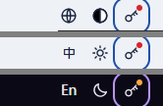

<p align="center"></p>

# MathTran

**圖片中的數學公式 → LaTeX → 預覽 → 匯出 SVG / PDF**

🌐 繁體中文 ｜ [English](https://github.com/codemee/mathtran/blob/main/README.en.md) ｜ 技術文件：[架構與設計（中文）](https://github.com/codemee/mathtran/blob/main/docs/zh-TW/architecture.md)


## 它能做什麼

| 步驟 | 說明 |
|---|---|
| ① 加入圖片 | **一次處理多張**：貼上（Ctrl+V）、拖曳檔案或整個資料夾、按「加入檔案」「加入資料夾」，隨時可再加；重複的圖片自動略過。支援 PNG / JPEG / WebP / GIF |
| ② 辨識為 LaTeX | 用 Claude 視覺模型轉成 LaTeX；可只辨識**選取的**、**勾選的**或**全部**。辨識過的圖片有**快取**，不會重複呼叫 |
| ③ 檢視與修改 | 在左邊點選圖片，右邊就顯示它的 LaTeX，可直接修改（修改也會存進快取） |
| ④ 預覽 | 邊打邊看的「即時」預覽（離線可用），也可切到真正 LaTeX 編譯的「精準」預覽；太長的公式會自動縮小到**完整可見** |
| ⑤ 匯出 | 匯出 **SVG**（文字已轉外框）、**PDF**、**LaTeX (.tex)**，**格式可複選**；同樣可選**選取的**、**勾選的**或**全部** |

三種使用方式，共用同一套核心：

| 方式 | 指令 | 適合 |
|---|---|---|
| 桌面視窗 | `mathtran gui` | 一般使用，匯出時有「另存新檔」對話框 |
| 瀏覽器 | `mathtran serve` | 想在瀏覽器操作 |
| 命令列 | `mathtran ocr / render / convert` | 批次處理、整合進腳本 |

## 安裝

有兩種方式，擇一即可：

| 方式 | 適合 | 需要自己安裝 |
|---|---|---|
| **A. 下載安裝包**（Windows ZIP / macOS DMG） | 一般使用者，只想開視窗用 | 什麼都不用裝（已附帶 Tectonic） |
| **B. `uv tool install mathtran`** | 想用命令列、或已經有 Python 的人 | Tectonic |

### A. 下載安裝包

到 [Releases](https://github.com/codemee/mathtran/releases/latest) 下載：

| 系統 | 檔案 | 怎麼用 |
|---|---|---|
| Windows 10 / 11（x64） | `MathTran-<版本>-windows-x64.zip` | 解壓縮，執行 `MathTran.exe` |
| macOS（Apple Silicon，M1 以後） | `MathTran-<版本>-macos-arm64.dmg` | 開啟 DMG，把 MathTran 拖進「應用程式」 |

- 目前只提供 **Apple Silicon**（M1 以後）的 macOS 安裝包；**Intel Mac 請改用方式 B**（`uv tool install mathtran`）
- 安裝包**沒有程式碼簽章**（作者沒有付費的開發者憑證）：
  - Windows 出現 SmartScreen 警告時，按「其他資訊」→「仍要執行」
  - macOS 第一次請在 App 上按**右鍵 →「打開」**，或到「系統設定 → 隱私權與安全性」按「仍要打開」
- 每個檔案旁邊的 `SHA256SUMS.txt` 可用來核對下載是否完整
- macOS 版由雲端打包並做自動檢查，**作者沒有在實體 Mac 上測試過**；遇到問題請到 [Issues](https://github.com/codemee/mathtran/issues) 回報
- 安裝包是視窗程式（沒有主控台），命令列功能有限；要用命令列請用方式 B

### B. 用 uv 安裝（PyPI）

需求：

| 項目 | 說明 |
|---|---|
| [uv](https://docs.astral.sh/uv/) | 會自動準備 Python（3.12 以上） |
| Tectonic | 用來編譯 LaTeX（匯出與精準預覽需要） |

步驟：

1. 安裝 Tectonic：
   - Windows：`scoop install tectonic`
   - macOS / Linux：`brew install tectonic`
2. 安裝 MathTran：
   ```bash
   uv tool install mathtran
   ```
   之後更新用 `uv tool upgrade mathtran`
3. 啟動：`mathtran gui`（或 `mathtran serve` 在瀏覽器使用）

### 設定 API key

圖片辨識需要 Anthropic API key（只做「LaTeX → SVG / PDF / .tex」不需要）。擇一：

- 桌面 / 網頁介面右上角工具列的**鑰匙圖示**（尚未設定時圖示右上角有紅點）
- 指令：`mathtran config --api-key <你的 KEY>`
- 環境變數：`ANTHROPIC_API_KEY`

> ⚠️ **第一次編譯會比較久**：Tectonic 需要連網下載 LaTeX 套件（約數分鐘），之後就會很快。
> ⚠️ 公式含中文時需要系統有中文字型（Windows 內建「微軟正黑體」、macOS 內建「PingFang TC」）。
> ⚠️ 作者只在 **Windows 11** 實際測試過；macOS / Linux 預期可用，但尚未驗證。
## 使用說明

### 工具列：語言、配色、API key

視窗右上角的工具列有三個圖示按鈕。語言和配色都是**三態按鈕**，每按一下輪流切到下一個狀態：



由左到右依序是「語言」「配色」「API key」；三列分別是三種狀態組合的實際樣子：

| 按鈕 | 輪流切換的狀態（圖示） | 說明 |
|---|---|---|
| 語言 | 地球 → 「中」→「En」 | 跟隨系統 → 繁體中文 → English。「跟隨系統」：系統是中文就用繁體中文，否則用 English |
| 配色 | 半黑半白的圓 → 太陽 → 月亮 | 跟隨系統 → 淺色 → 深色。「跟隨系統」：依作業系統的深色 / 淺色模式決定 |
| API key | 鑰匙 | 開啟設定對話框；**尚未設定時，鑰匙右上角會有紅點** |

滑鼠停在按鈕上會顯示目前狀態；切換後狀態列也會說明（例如「語言：English」）。

**兩組配色**（只借用配色，沒有使用任何標誌或圖案；相關名稱與商標屬於各自的權利人，本專案與其無關）：

| 配色 | 主題 | 色彩 |
|---|---|---|
| 淺色 | 鋼彈 RX-78-2 | 白色機身為底、鋼彈藍為主色，點綴紅與黃 |
| 深色 | 新世紀福音戰士 | 深紫黑為底、初號機紫為主色，點綴螢光綠與橘 |

畫面全部使用純色，不使用漸層。兩組配色的文字對比度都經過檢查（一般文字不低於 4.5:1）。

| 淺色（鋼彈 RX-78-2） | 深色（新世紀福音戰士） |
|---|---|
|  |  |

**語言**會套用到整個畫面，包含狀態列與錯誤訊息（辨識失敗、編譯失敗等後端訊息也會用同一種語言）。命令列的執行結果訊息會依序參考環境變數 `MATHTRAN_LANG`、你在介面選的語言、系統語言；`--help` 說明文字目前只有中文。

**設定會被記住**：語言、配色、縮圖大小、匯出格式都存在 `~/.mathtran/config.json`，桌面版與網頁版共用，重開後仍保留。

### 桌面 / 網頁介面

1. **加入圖片**（隨時都可以再加）
2. 在左邊**點選**一張圖片，右邊就顯示它的 LaTeX；需要時直接修改
3. 按左下角的 **辨識**，選擇範圍（見下表）
4. 在預覽區右上角按 **精準** 看真正的 LaTeX 排版結果（按 **即時** 可切回）
5. 在右下角勾選要匯出的格式（SVG / PDF / LaTeX 可複選），再選範圍按 **匯出**

#### 預覽區

預覽區右上角有三個**透明背景**的按鈕，直接壓在預覽畫面上：

| 按鈕 | 功能 |
|---|---|
| 即時 | KaTeX 即時預覽，邊打邊看（離線可用） |
| 精準 | 用 Tectonic 真正編譯的結果，與匯出的 SVG / PDF 一致；可隨時按「即時」切回，來回切換不會重新編譯 |
| 複製 LaTeX | 複製目前圖片的 LaTeX 原始碼 |

- 你修改 LaTeX 或換一張圖時，會自動回到「即時」（精準預覽需要重新編譯，不會自動做）
- **公式太長時會自動縮小字級，讓整個公式完整看得到**（縮放有下限，極端長的公式仍可橫向捲動）

#### 加入圖片的方式

| 方式 | 說明 |
|---|---|
| 貼上 | 直接 Ctrl+V 貼上截圖，可連續貼多張（命名為「貼上-001.png」…） |
| 加入檔案 | 可一次選多個圖檔 |
| 加入資料夾 | 加入資料夾內所有圖片（含子資料夾），依檔名排序 |
| 拖曳 | 把檔案或整個資料夾拖進視窗 |

> 內容完全相同的圖片只會加入一次（以內容判斷，不是檔名）。

#### 圖片清單怎麼看

每張圖都以縮圖完整顯示，**勾選框和狀態標籤疊在圖片上方，檔名在圖片下方的說明列**（太長的檔名會用中間省略，滑鼠移上去看完整路徑）：

| 標示 | 意義 |
|---|---|
| ☑ 左上角勾選框 | 勾選後可做「勾選的」批次辨識 / 匯出 |
| 藍框 | 目前選取的圖片，右邊顯示的就是它 |
| 未辨識 | 還沒有 LaTeX |
| 已辨識 | 剛剛辨識完成 |
| 已快取 | 先前辨識過，直接從快取帶出，沒有呼叫 API |
| 已修改 | 你手動改過 LaTeX |
| 失敗 | 辨識失敗；把滑鼠移到標籤上可看原因 |

縮圖大小可用清單上方的滑桿調整。鍵盤：方向鍵移動選取、空白鍵切換勾選。

#### 辨識與匯出的範圍

左邊「辨識」和右邊「匯出」各有三個按鈕：

| 按鈕 | 對象 |
|---|---|
| 選取的 | 目前點選（藍框）的那一張 |
| 勾選的 (n) | 已打勾的圖片 |
| 全部 (n) | 清單內所有圖片 |

- **辨識**：已經有結果的圖片會自動略過，不會重複辨識；批次辨識時同時處理 3 張，可按「停止」中斷。要強制重新辨識，勾選「忽略快取」（會覆蓋你的手動修改，並先詢問確認）
- **匯出**：還沒有 LaTeX 的圖片會略過並提示。**格式用核取方塊複選**（至少留一個），可一次輸出多種：

  | 格式 | 內容 |
  |---|---|
  | SVG | 向量圖，文字已轉外框，在沒有字型的電腦上也正常顯示 |
  | PDF | 裁切到剛好包住公式的單頁 PDF |
  | LaTeX (.tex) | **完整、可自行編譯的文件**（含 `\documentclass` 與所需套件），不需要 Tectonic；含中文時檔頭會註明要用 XeLaTeX |

  只有「一張圖 × 一種格式」時是「另存新檔」；其餘（多張或多種格式）會一起輸出：

  | 版本 | 多個檔案的輸出方式 |
  |---|---|
  | 桌面視窗 | 跳出「選擇資料夾」，每個檔案檔名取自圖檔名（如 `二次公式.svg`、`二次公式.tex`）；同名自動加 `_2`，資料夾內已有同名檔案時不覆蓋（改成 `名稱 (2)`） |
  | 瀏覽器 | 下載成 `mathtran-export-svg-pdf.zip`（檔名依所選格式而定） |

  個別圖片編譯失敗不會中斷整批（該圖的 `.tex` 仍會輸出），原因會寫在 `errors.txt`。你選的格式會被記住。

#### 辨識快取

| 項目 | 說明 |
|---|---|
| 鍵 | 圖片內容的 SHA-256（改檔名、換資料夾都不影響） |
| 內容 | 只存 LaTeX（與是否被你修改過），**不存圖片** |
| 位置 | `~/.mathtran/cache.json`，桌面、網頁、命令列共用 |
| 效果 | 關掉重開、把圖片移除後再加入，都會直接帶出結果 |
| 版本 | 辨識提示詞改版時，舊版本辨識的結果會視為過期、重新辨識；**你手動修改過的結果永遠保留**。例如現在的版本會把圖上的**中文標題與說明文字**一起轉錄成 `\text{…}`，更早版本辨識的結果因為會漏掉文字，所以不再沿用 |
| 查看 / 清除 | 桌面或網頁介面左側窗格「辨識」那一列右端的 **快取…** 按鈕；或命令列 `mathtran cache` / `mathtran cache --clear` |

按 **快取** 會開啟對話框，顯示目前有幾筆快取（其中幾筆是你手動修改的）、檔案大小與位置，並提供兩種清除：

| 按鈕 | 效果 |
|---|---|
| 清除清單內圖片的快取 | 只刪除目前清單裡這些圖片的快取，清單以外的保留 |
| 清除全部快取 | 刪除所有快取（有手動修改的結果時會先再確認一次） |

- 清除後，清單內對應圖片目前顯示的結果也會一併清掉（變回「未辨識」），下次辨識要重新呼叫 API（會花費用）
- **你手動修改過的結果也會被清除，無法復原**；若想保留，請先匯出或複製 LaTeX
- 辨識或匯出進行中無法清除

視窗最下方的**狀態列**會顯示目前動作與結果：

| 位置 | 內容 |
|---|---|
| 左側 | 進度、成功訊息（例如「已儲存：C:\\…\\formula.pdf」）、錯誤（紅色） |
| 右側 | `API key ✓`、`tectonic ✓`；未設定時顯示紅色警告 |

### 命令列

| 指令 | 功能 |
|---|---|
| `mathtran ocr 圖片.png [--no-cache]` | 辨識圖片，把 LaTeX 印到螢幕（辨識過的用快取；`--no-cache` 強制重辨） |
| `mathtran render "E=mc^2" -o out.svg` | LaTeX → SVG 或 PDF（副檔名決定格式） |
| `mathtran convert 圖片.png -o out.pdf [--no-cache]` | 辨識並匯出，一步完成 |
| `mathtran cache [--clear]` | 查看快取筆數與位置；`--clear` 清除 |
| `mathtran config --api-key KEY` | 儲存 API key（存於使用者目錄 `~/.mathtran/`） |
| `mathtran serve [--port 8765]` | 啟動網頁介面 |
| `mathtran gui` | 啟動桌面視窗 |

範例：

```bash
# 圖片 → PDF
mathtran convert formula.png -o formula.pdf

# 從標準輸入讀 LaTeX
echo '\begin{pmatrix}a&b\\c&d\end{pmatrix}' | mathtran render - -o matrix.svg
```

### 公式小技巧

- 不用自己加 `$…$` 或 `\[…\]`，MathTran 會自動包上
- `pmatrix`、`aligned` 這類環境可直接寫；`align`、`equation` 等自帶數學模式的環境會原樣使用
- 公式裡的**中文**會自動處理（加上中文字型與 `\text{}`）；要換字型請設定環境變數 `MATHTRAN_CJK_FONT`

## 常見問題

| 狀況 | 原因與處理 |
|---|---|
| 狀態列顯示「⚠ 未設定 API key」 | 依「安裝」第 3 步設定 |
| 狀態列顯示「⚠ 找不到 tectonic」 | 執行 `scoop install tectonic`（或 `brew install tectonic`），重開 MathTran |
| 第一次匯出等很久 | Tectonic 正在下載套件，請保持連網並耐心等待 |
| 找不到中文字型 | 安裝字型，或設定 `MATHTRAN_CJK_FONT` 為你系統上的字型名稱 |
| Windows 安裝包一開啟就出現「Unhandled exception in script」，內容有 `Failed to resolve Python.Runtime.Loader.Initialize …` | 這是 **0.1.0 的 Windows 安裝包才有的問題**（瀏覽器下載的 ZIP 解壓縮後，檔案帶有「來自網際網路」標記，.NET 因此拒絕載入元件），**0.1.1 起已修正**。0.1.0 的解法：把資料夾裡所有檔案解除封鎖——在 PowerShell 執行 `Get-ChildItem -Recurse <解壓縮後的資料夾> \| Unblock-File`，或對 ZIP 按右鍵 →「內容」→ 勾選「解除封鎖」後**重新解壓縮** |
| 辨識結果不對 | 辨識結果可以直接在文字框修改；圖片盡量裁切到只剩公式、解析度高一點 |
| 按了辨識卻說「都已有辨識結果」 | 已辨識過的圖片會略過；要重辨請勾選「忽略快取」。（已經在清單裡的舊結果不會自動更新；把它們移除再重新加入，或勾「忽略快取」重辨） |
| 圖上的中文沒有被辨識出來 | 舊版會漏掉文字；新版會連中文一起轉錄。舊結果請移除後重新加入再辨識，或勾「忽略快取」 |
| 加入圖片時說「重複已略過」 | 內容相同的圖片只會加入一次 |

## 隱私

- **辨識時，圖片會上傳到 Anthropic API**；請勿用於不能外傳的內容
- 預覽、匯出都在本機完成，不會上傳
- API key 只存在你本機的 `~/.mathtran/config.json`
- 辨識快取（`~/.mathtran/cache.json`）只含 LaTeX 文字，不含圖片

## 授權

採用 [GPL-3.0-or-later](https://github.com/codemee/mathtran/blob/main/LICENSE)（GNU 通用公共授權第 3 版或更新版本）。

| 你想做的事 | 需要注意 |
|---|---|
| 自己使用、修改 | 沒有限制 |
| 散布（含修改後版本、打包成 App） | 必須同樣以 GPL-3.0 以上授權，並附上或提供原始碼 |
| 對外提供網路服務 | 因為相依 PyMuPDF（AGPL-3.0），合併後的作品要遵守 AGPL 第 13 條：使用者透過網路互動時，必須能取得對應的原始碼 |

第三方元件與授權相容性請見 [THIRD_PARTY_NOTICES.md](https://github.com/codemee/mathtran/blob/main/THIRD_PARTY_NOTICES.md)。
