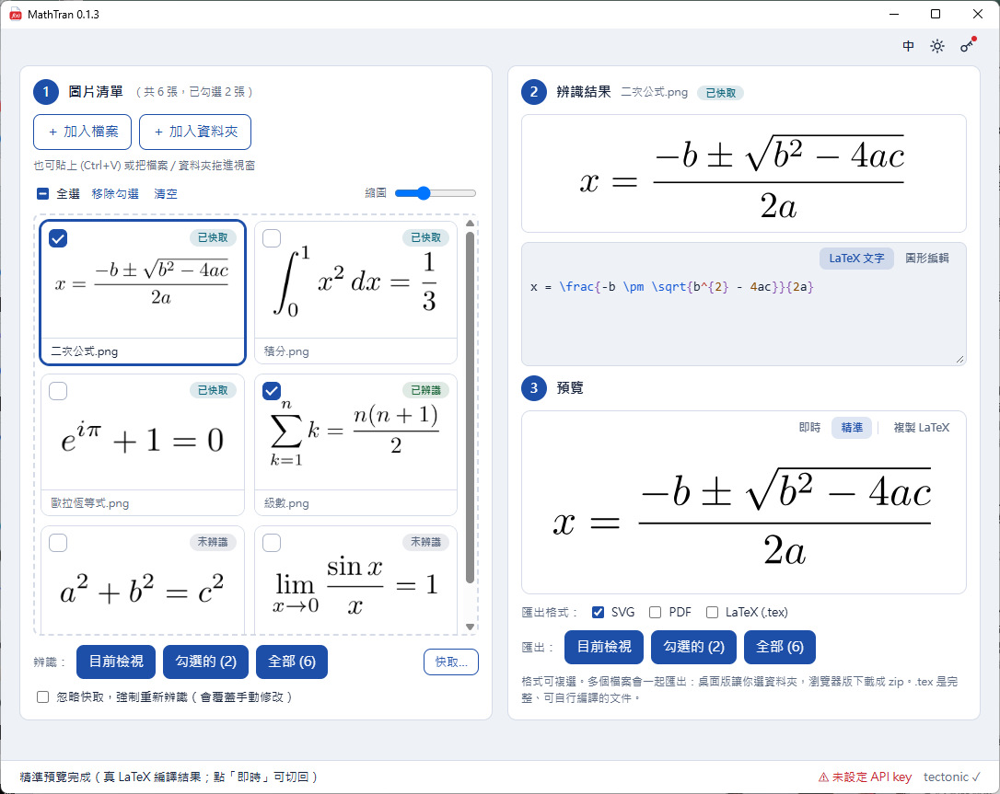

<p align="center"></p>

# Mathtran

**圖片中的數學公式 → LaTeX → 預覽 → 匯出 SVG / PDF**

🌐 繁體中文 ｜ [English](https://github.com/codemee/mathtran/blob/main/README.en.md) ｜ 技術文件：[架構與設計（中文）](https://github.com/codemee/mathtran/blob/main/docs/zh-TW/architecture.md)



## 它能做什麼

| 步驟 | 說明 |
|---|---|
| ① 貼上圖片 | 截圖貼上（Ctrl+V）、拖曳檔案、或點選檔案；支援 PNG / JPEG / WebP / GIF |
| ② 辨識為 LaTeX | 用 Claude 視覺模型轉成 LaTeX，結果可直接編輯修正 |
| ③ 預覽 | 邊打邊看的即時預覽（離線可用），也可用真正的 LaTeX 編譯做「精準預覽」 |
| ④ 匯出 | 匯出 **SVG**（文字已轉外框）或 **PDF**；也能複製 LaTeX 原始碼 |

三種使用方式，共用同一套核心：

| 方式 | 指令 | 適合 |
|---|---|---|
| 桌面視窗 | `mathtran gui` | 一般使用，匯出時有「另存新檔」對話框 |
| 瀏覽器 | `mathtran serve` | 想在瀏覽器操作 |
| 命令列 | `mathtran ocr / render / convert` | 批次處理、整合進腳本 |

## 安裝

### 需求

| 項目 | 說明 |
|---|---|
| Python | 3.14 以上，建議用 [uv](https://docs.astral.sh/uv/) 管理 |
| Tectonic | 用來編譯 LaTeX（匯出與精準預覽需要） |
| Anthropic API key | 圖片辨識需要；只做「LaTeX → SVG/PDF」不需要 |
| 中文字型 | 公式含中文時使用，Windows 內建「微軟正黑體」 |

### 步驟

1. 安裝 Tectonic：
   - Windows：`scoop install tectonic`
   - macOS / Linux：`brew install tectonic`
2. 安裝 Mathtran：
   ```bash
   uv tool install git+https://github.com/codemee/mathtran
   ```
3. 設定 API key（擇一）：
   - 環境變數：`ANTHROPIC_API_KEY`
   - 指令：`mathtran config --api-key <你的 KEY>`
   - 桌面 / 網頁介面右上角的「API key」按鈕
4. 啟動：`mathtran gui`

> ⚠️ **第一次編譯會比較久**：Tectonic 需要連網下載 LaTeX 套件（約數分鐘），之後就會很快。
> ⚠️ 目前只在 **Windows 11** 實際測試過；macOS / Linux 預期可用，但尚未驗證。

## 使用說明

### 桌面 / 網頁介面

1. 把含公式的圖片貼上或拖進左側區塊
2. 按 **辨識為 LaTeX**
3. 在右側修正 LaTeX，下方預覽會即時更新
4. 按 **精準預覽** 看真正的 LaTeX 排版結果
5. 按 **匯出 SVG** 或 **匯出 PDF**

視窗最下方的**狀態列**會顯示目前動作與結果：

| 位置 | 內容 |
|---|---|
| 左側 | 進度、成功訊息（例如「已儲存：C:\\…\\formula.pdf」）、錯誤（紅色） |
| 右側 | `API key ✓`、`tectonic ✓`；未設定時顯示紅色警告 |

### 命令列

| 指令 | 功能 |
|---|---|
| `mathtran ocr 圖片.png` | 辨識圖片，把 LaTeX 印到螢幕 |
| `mathtran render "E=mc^2" -o out.svg` | LaTeX → SVG 或 PDF（副檔名決定格式） |
| `mathtran convert 圖片.png -o out.pdf` | 辨識並匯出，一步完成 |
| `mathtran config --api-key KEY` | 儲存 API key（存於使用者目錄 `~/.mathtran/`） |
| `mathtran serve [--port 8765]` | 啟動網頁介面 |
| `mathtran gui` | 啟動桌面視窗 |

範例：

```bash
# 圖片 → PDF
mathtran convert formula.png -o formula.pdf

# 從標準輸入讀 LaTeX
echo '\begin{pmatrix}a&b\\c&d\end{pmatrix}' | mathtran render - -o matrix.svg
```

### 公式小技巧

- 不用自己加 `$…$` 或 `\[…\]`，Mathtran 會自動包上
- `pmatrix`、`aligned` 這類環境可直接寫；`align`、`equation` 等自帶數學模式的環境會原樣使用
- 公式裡的**中文**會自動處理（加上中文字型與 `\text{}`）；要換字型請設定環境變數 `MATHTRAN_CJK_FONT`

## 常見問題

| 狀況 | 原因與處理 |
|---|---|
| 狀態列顯示「⚠ 未設定 API key」 | 依「安裝」第 3 步設定 |
| 狀態列顯示「⚠ 找不到 tectonic」 | 執行 `scoop install tectonic`（或 `brew install tectonic`），重開 Mathtran |
| 第一次匯出等很久 | Tectonic 正在下載套件，請保持連網並耐心等待 |
| 找不到中文字型 | 安裝字型，或設定 `MATHTRAN_CJK_FONT` 為你系統上的字型名稱 |
| 辨識結果不對 | 辨識結果可以直接在文字框修改；圖片盡量裁切到只剩公式、解析度高一點 |

## 隱私

- **辨識時，圖片會上傳到 Anthropic API**；請勿用於不能外傳的內容
- 預覽、匯出都在本機完成，不會上傳
- API key 只存在你本機的 `~/.mathtran/config.json`

## 授權

採用 [GPL-3.0-or-later](https://github.com/codemee/mathtran/blob/main/LICENSE)（GNU 通用公共授權第 3 版或更新版本）。

| 你想做的事 | 需要注意 |
|---|---|
| 自己使用、修改 | 沒有限制 |
| 散布（含修改後版本、打包成 App） | 必須同樣以 GPL-3.0 以上授權，並附上或提供原始碼 |
| 對外提供網路服務 | 因為相依 PyMuPDF（AGPL-3.0），合併後的作品要遵守 AGPL 第 13 條：使用者透過網路互動時，必須能取得對應的原始碼 |

第三方元件與授權相容性請見 [THIRD_PARTY_NOTICES.md](https://github.com/codemee/mathtran/blob/main/THIRD_PARTY_NOTICES.md)。
