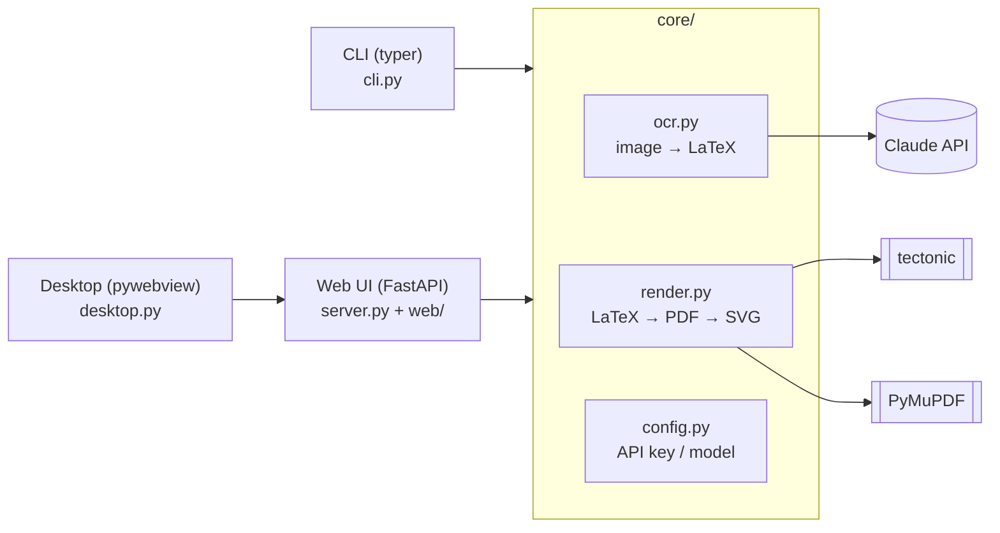
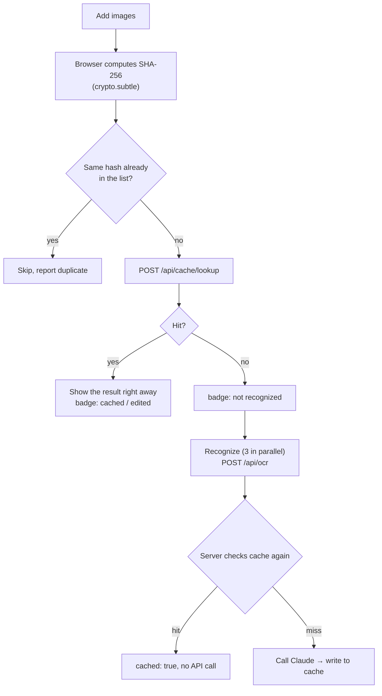
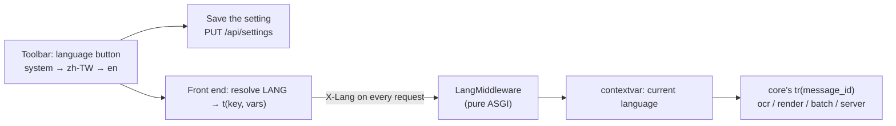

# Architecture & design

🌐 English ｜ [繁體中文](https://github.com/codemee/mathtran/blob/main/docs/zh-TW/architecture.md) ｜ [Back to README](https://github.com/codemee/mathtran/blob/main/README.en.md)

## Overview

Three entry points share one `core`:



The desktop app is just "a pywebview window + a local FastAPI server", sharing the same front end as the web version.

## Modules

| File | Responsibility |
|---|---|
| `core/ocr.py` | `recognize()`: checks the cache first, calls the Claude vision API only on a miss; `clean_latex` strips code fences and `$$` / `\[ \]` |
| `core/cache.py` | Recognition cache keyed by the image's SHA-256, stored in `~/.mathtran/cache.json` (thread lock + atomic writes; a corrupt file is treated as empty) |
| `core/batch.py` | Batch export to a zip: file-name sanitizing and de-duplication (case-insensitive), per-item failures don't stop the batch, errors go to `errors.txt` |
| `core/render.py` | Wraps the formula in a `standalone` document → tectonic compiles to PDF → PyMuPDF converts to SVG |
| `core/config.py` | API key (env var first, then `~/.mathtran/config.json`), model name, and validation / saving of the UI preferences (language, theme, thumbnail size, export formats) |
| `core/i18n.py` | Multi-language messages for the back end: `tr()`, language resolution, the contextvar |
| `cli.py` | Subcommands `ocr` / `render` / `convert` / `config` / `serve` / `gui` |
| `server.py` | FastAPI: API plus static front end |
| `desktop.py` | pywebview window, "Save as" / "choose folder" export APIs, window icon |
| `web/index.html` | Single-file front end (image list, batch recognition and export); `web/vendor/` bundles KaTeX (live preview) and MathLive (visual editor), both usable offline |

## HTTP API

| Method and path | Description |
|---|---|
| `GET /api/health` | Reports whether the API key and tectonic are available |
| `POST /api/config` | Saves the API key |
| `GET /api/settings` | Returns `{lang, theme, thumb, formats}` |
| `PUT /api/settings` | Partially updates the UI preferences; one invalid field rejects the whole request (400) |
| `POST /api/ocr[?force=true]` | Upload an image (multipart `file`); returns `{latex, hash, cached}`; `force=true` ignores the cache |
| `POST /api/cache/lookup` | Send `{hashes: [...]}`; returns the hits as `{hash: {latex, edited}}` |
| `PUT /api/cache/{sha256}` | Send `{latex}`; stores a manual edit (flagged `edited`) |
| `GET /api/cache` | Returns `{count, edited, bytes, path}` (entries, how many were hand-edited, file size, location) |
| `DELETE /api/cache` | Clears the whole cache; returns `{removed}` |
| `POST /api/cache/remove` | Send `{hashes: [...]}`; clears only those images' cache; returns `{removed}` |
| `POST /api/export/svg`, `/pdf`, `/tex` | Send `{latex}`; returns a single file (`tex` is a complete, compilable document and needs no tectonic) |
| `POST /api/export/batch` | Send `{formats: ["svg","pdf","tex"], items: [{name, latex}]}`; returns a zip; headers `X-Ok-Count` (files written) / `X-Fail-Count` (items that failed or were skipped) |

The server binds to `127.0.0.1` only.

## Multi-image handling and the cache



- **The cache key is the SHA-256 of the image content**, so renaming or moving a file still hits. The browser and the server compute it independently; identical bytes give identical hashes.
- **Two layers of protection**: the front end skips items that already have a result (no request at all), and even if a request is sent, the server's `recognize()` checks the cache first. So CLI, web and desktop share one cache.
- **Manual edits are written back** (`PUT /api/cache/{hash}`, 500 ms debounce, flushed immediately before switching image / recognizing / exporting) and flagged `edited`. A forced re-recognition (`force`) overwrites it, after a `confirm()` in the UI.
- **Clearing the cache**: the "Cache" dialog can clear everything, or only the images in the list (by hash). After clearing, the front end also zeroes the results of the listed items (`resetResults`) and cancels the pending "save manual edit" timers; otherwise a pending edit would write the just-cleared entry back. Clearing is refused while recognition / export runs (`S.busy`), so a finishing recognition can't write results back.
- **Scopes** (current / checked / all) only choose *which items* go through the same flow: only items without a result are recognized, unless "ignore cache" is ticked.
- **Failures**: an individual failure only marks that image; an error mentioning "API key" is treated as fatal and aborts the batch (so you don't get one failure per image).
- **Prompt version (`ocr.PROMPT_VERSION`)**: every cache record carries the `prompt` version. It is bumped whenever the prompt changes; results from older versions that were not hand-edited count as stale (`cache.get/lookup(min_prompt=…)` don't return them) and are recognized again; `edited=True` entries are always valid; a manual edit never silently upgrades `prompt`. v1 transcribed only formulas and dropped Chinese text in the image; v2 asks for all text, as `\text{…}`.
- **Batch export**: formats are multi-select (`formats`). Each item is compiled at most once (svg and pdf share the same PDF); `.tex` needs no compilation, so it is still written when compilation fails. The front end sends every item that has a result to `/api/export/batch`; the server compiles them one by one and zips them. The desktop app then lets the user pick a folder through `js_api.save_zip_to_folder` and extracts there (`extract_zip`: keeps only the file name to prevent path traversal, never overwrites existing files); the browser version just downloads the zip.

## Language, theme and settings

**Language (Traditional Chinese / English / follow system)**



- **Front end**: every string lives in the `I18N` dictionary and is fetched with `t(key, vars)`; when `vars.n === 1` and a `key_one` entry exists, the singular form is used (English needs it). Static HTML is tagged with `data-i18n` / `data-i18n-title` / `data-i18n-html` and applied by `applyStatic()`; dynamic content (badges, button counts, placeholders) is looked up when `renderList` / `updateCounts` / `syncRight` run.
- **Status-bar messages are re-translated when the language changes**: `status(key, vars, kind)` remembers the key, whereas `setStatus(text)` shows text as-is (errors returned by the back end, pre-assembled messages). `applyLanguage()` redraws everything on a switch.
- **"Follow system"**: the front end uses `navigator.language` (`zh*` → Traditional Chinese, anything else → English); the back end (command line) uses `GetUserDefaultUILanguage()` on Windows or `LANG`.
- **Back-end messages follow the language**: every request carries `X-Lang` (already resolved to `zh-TW` or `en`). `LangMiddleware` stores it in a contextvar, and when `core` raises an error it uses `tr()` to pick the message in the current language — so recognition failures, compile failures, the batch `errors.txt` and the comment in a `.tex` header are all in the same language.
- **Resolution order** (`i18n.current_lang()`): request header → `MATHTRAN_LANG` environment variable → the UI preference (config file) → system language.
- The front end decides that "no key set = fatal, abort the batch" by looking for "API key" inside the message, so this message must contain that string in both languages (a test guards it).

**Theme (follow system / light / dark)**

- Light is **Gundam RX-78-2** (white, blue, red, yellow) and dark is **Neon Genesis Evangelion** (deep purple-black, purple, neon green, orange). Only the colors are borrowed — no logos or artwork — and everything is flat, solid color: **no gradients** (a test scans the computed styles of the whole page, and the raw CSS).
- Implementation: `:root` defines the light variables; `@media (prefers-color-scheme: dark)` applies the dark ones under `:root:not([data-theme="light"])`; a manual choice sets `<html data-theme="light|dark">` to override the system, and `color-scheme` switches with it so form controls and scrollbars follow.
- **Accent for text and the solid button color are separate**: `--accent` (text / outlines) and `--accent-solid` (solid buttons, checkboxes). The light purple of the dark scheme reads well as text but lacks contrast as a solid background behind white text, so a deeper purple is used there.
- **Contrast is tested**: normal text, secondary text, the accent, buttons and every status badge (including the badge's own 14% tinted background) are checked against WCAG 4.5:1 in both schemes. That check caught the light scheme's green / teal / amber badges falling short (4.34 / 4.42 / 3.72); they were darkened.
- The accurate preview is a black-on-transparent SVG, so it gets a white backing in the dark scheme — otherwise it would be invisible.

**Saving settings**

- Language, theme, thumbnail size and export formats are stored under `settings` in `~/.mathtran/config.json` (`GET/PUT /api/settings`; fields are validated, an invalid one rejects the whole request, and a corrupt file falls back to defaults).
- **Not `localStorage`**: the desktop app's local port differs on every launch and `localStorage` is keyed by origin (including the port), so it is lost on restart; the earlier "thumbnail size / export formats are remembered" claim could not actually hold in the desktop app.
- Unsent changes accumulate (`pendingPatch`): the thumbnail slider is debounced by 400 ms, and changing another setting in that window must not swallow the earlier one (a test caught this bug).

## Rendering pipeline
```mermaid
flowchart LR
    A[Raw LaTeX] --> B{Contains CJK?}
    B -- yes --> C[Wrap in \text{} + load xeCJK]
    B -- no --> D
    C --> D[wrap_latex: add \[ \] if needed]
    D --> E[tectonic compile]
    E --> F[PDF]
    F --> G[PyMuPDF get_svg_image<br/>text_as_path=True]
    G --> H[SVG]
```

- **Automatic math mode**: the formula is wrapped in `\[ \]`; environments that bring their own math mode (`align`, `equation`, …) are used unchanged (see `_STANDALONE_ENV`). `pmatrix` and `aligned` are **not** standalone and need the wrapper.
- **SVG text as outlines**: `text_as_path=True`, so the SVG renders correctly on machines without the fonts.

## Design decisions and pitfalls

| Topic | Decision / reason |
|---|---|
| CJK font by *name* | Selecting a font by file path (e.g. `C:/Windows/Fonts/msjh.ttc`) fails under tectonic; a system font *name* (`Microsoft JhengHei`) works. Override with `MATHTRAN_CJK_FONT` |
| Bare CJK must be in `\text{}` | Math mode does not typeset Chinese; `wrap_cjk_in_text` wraps CJK runs that are not already inside `\text{}` (the KaTeX preview has an equivalent JS version) |
| xeCJK only when needed | Not loaded unless the content has CJK, avoiding an unnecessary font dependency and compile time |
| Visual editor (MathLive) | Loaded with a `<script>` from `vendor/mathlive/` (about 1.1 MB with fonts) only the first time "Visual editor" is clicked, so startup is unaffected. Both editing modes share `applyEdit(value)`: the visual editor writes back with `getValue("latex")` only on user input (`input` events); switching images or modes pushes content in with `setValue(…, {silenceNotifications:true})`, so merely looking never changes the content. Chinese is wrapped into `\text{}` with `CJK_RUN` before pushing; long formulas wrap: MathLive has no wrapping option (anything beyond the field is just scrolled with the caret), so a style (`GFX_WRAP_CSS`) is appended inside its shadow DOM to let the top-level items break lines and the field grow taller; this depends on its internal class names (`.ML__latex` / `.ML__content`) and must be rechecked when upgrading MathLive; the virtual keyboard uses the `manual` policy (only opens from the keyboard icon) and key sounds are off |
| Syntax highlighting in the LaTeX editor | No editor library: a transparent `<textarea>` sits on a same-size `<pre id="hl">`; `hlTokens()` splits the text into commands / braces / numbers / text / comments and `hlRender()` repaints. Font, border, padding, wrapping and `scrollbar-gutter` must be identical on both layers or the text drifts (`tests/test_highlight.py` runs the tokenizer under node and checks color contrast); `textarea::selection` must be translucent, otherwise its background hides the layer below; the brace match next to the caret refreshes on `keyup` / `mouseup` / `focus` |
| Desktop export uses "Save as" | pywebview blocks downloads by default (`ALLOW_DOWNLOADS`), so the front end detects `window.pywebview.api.save_file` and saves through `js_api` |
| **Never expose `window` as a public attribute of the `js_api` object** | pywebview recursively walks **every attribute not starting with an underscore** of the `js_api` object. A public `Window` reference makes it walk into native WinForms controls, causing an intermittent whole-process freeze (about 1 in 6 launches). Always use `_window` |
| Window icon | pywebview has no icon parameter on Windows; we set it with `LoadImageW` + `WM_SETICON` |
| Status bar | All progress, results and errors go to the bottom bar; `setErr("")` clears only *errors*, so it never overwrites "Saved: path" |
| Cloud-only OCR | Local pix2tex would pull in PyTorch (1–2 GB when packaged), so it was dropped |
| Blocking endpoints must not be `async def` | `/api/ocr` started as `async def` but made blocking network calls, stalling the whole event loop; during parallel batch recognition even cache lookups were held up. It is now a plain `def`, run in FastAPI's thread pool |
| Route order | `POST /api/export/batch` must be registered **before** `/api/export/{fmt}`, otherwise `batch` is taken as a format and returns 404 |
| Image list uses a fixed height, not `aspect-ratio` | In CSS Grid, `aspect-ratio` is not used when computing row heights, so cards overlapped (the next row covered the previous row's image). Now `height: calc(var(--thumb) * .75)` |
| Thumbnails use `object-fit: contain` | The whole image is visible, uncropped; checkbox and badge are absolutely positioned over the picture area, while the file name is a separate caption strip below it (it never covers the image; long names get a JS "middle ellipsis" so the distinguishing end stays visible) |
| No flex centering for the preview | With `display:flex; justify-content:center`, content wider than the container overflows to the left, where it is clipped and unreachable. The preview is now a normal block with `text-align:center` |
| Don't measure `.katex` to decide whether a formula is too wide | In display mode `.katex` is always as wide as its container (the content overflows), so it never reveals the real width; and `scrollWidth` can't be used as the content width either (without overflow it equals `clientWidth`, which looks like an overflow). `fitPreview()` shrinks only when `scrollWidth > clientWidth`, re-checking until it no longer overflows (lower bound `PV_MIN_SCALE`) |
| Live / accurate preview state | `S.pv` is `live` or `acc`; the accurate result is stored in `item.acc = {latex, url}` and is valid only while `latex` is unchanged, so switching back and forth never recompiles and editing returns to live |
| Tests are isolated from your cache | `tests/conftest.py` points `config.CONFIG_PATH` at a temp folder so tests never touch your real cache; `cache_path()` is computed on every call |
| PyMuPDF must stay on 1.x (`pymupdf>=1.28,<2`) | 2.x lists `pymupdf-layout`, `pymupdf4llm`, `onnxruntime`, `numpy` and more as hard dependencies. Consequences: much larger packages (the ZIP went from 117 MB to 65 MB), `onnxruntime` has no macOS Intel wheel (so the Intel build failed in CI), and `pymupdf-layout` / `pymupdf4llm` declare no license on PyPI. We only use the basics (open a PDF, convert to SVG, draw the icon), which 1.x covers fully |
| Printing Chinese crashes on CI's Windows | The Windows console on CI defaults to cp1252, so printing Chinese raises `UnicodeEncodeError` (the build had actually succeeded but failed on the last line). The build script switches stdout / stderr to UTF-8 first thing |
| The version in the title bar (`mathtran.__version__`) | `pyproject.toml` is the only source of the version; at run time it is read from the installed package's metadata with `importlib.metadata`. **PyInstaller does not bundle that metadata by itself**: `mathtran.spec` must call `copy_metadata("mathtran")`, otherwise the packaged app can't read it and the title loses its version. The self-test (`version` / `window_title_has_version`) and the smoke test (the title must be `MathTran <version>`) both catch this. The window title is also the string used to *find* the window (setting the icon, screenshots), so a single constant `APP_TITLE` is used everywhere |
| .NET refuses to load components from a browser-downloaded ZIP | Files carrying the "downloaded from the Internet" mark (Mark of the Web) are refused by .NET Framework by default, so pywebview's pythonnet fails. Fix: ship a `MathTran.exe.config` (`loadFromRemoteSources`). **Downloading with `gh` and extracting with PowerShell never adds the mark, so it went completely unnoticed at first**; `packaging/smoke_window.ps1` now simulates exactly this case |
| A marked exe must not be started with `Start-Process` | Launching through the shell shows a "publisher could not be verified" dialog and hangs; the test uses `CreateProcess` (`UseShellExecute = false`) instead |
| `tr()`'s first parameter must be positional-only | A placeholder in a message may be called `key` / `name`; if `tr(key, **kw)`'s own parameter were also called `key` they would collide (`got multiple values for argument`). It is now `tr(message_id, /, **kw)` |
| Pure ASGI middleware | With `BaseHTTPMiddleware` a contextvar is not reliably visible inside the sync endpoints FastAPI runs in its thread pool; a pure ASGI middleware (`__call__(scope, receive, send)`) is, and a test fires 24 mixed zh / en requests concurrently to prove messages never get mixed up |
| The screenshot tool must not photograph other windows | `packaging/screenshots.py` captures the screen: if the window is covered it would capture other content (possibly private). So it sets the window topmost and confirms it is the foreground window first, and fails without writing a file otherwise |

## Development

```bash
uv sync                                  # install dependencies (including dev)
uv run pytest -q                         # tests (they call real tectonic; first run is slow)
uv run mathtran gui                      # launch the desktop app
uv run python packaging/make_icon.py     # regenerate the icon (svg / ico / icns / png)
uv run python packaging/screenshots.py   # regenerate README screenshots (needs a Windows desktop)
TECTONIC_BIN=<path> uv run python packaging/build_dist.py   # build the installer locally (Windows → ZIP, macOS → DMG)
```

Two kinds of tests: OCR uses a mock client (no API cost); rendering and export use real tectonic.

## Releasing and packaging

The release process (tag → cloud tests, packaging, publishing to GitHub Releases and PyPI) is described in [Release process](https://github.com/codemee/mathtran/blob/main/docs/en/releasing.md).

## Not done yet

- Verification on real macOS / Linux machines (the macOS packages are only built and smoke-tested in CI for now)
- Code signing and notarization (Windows Authenticode, Apple Developer ID): these need paid certificates, so the packages are unsigned
