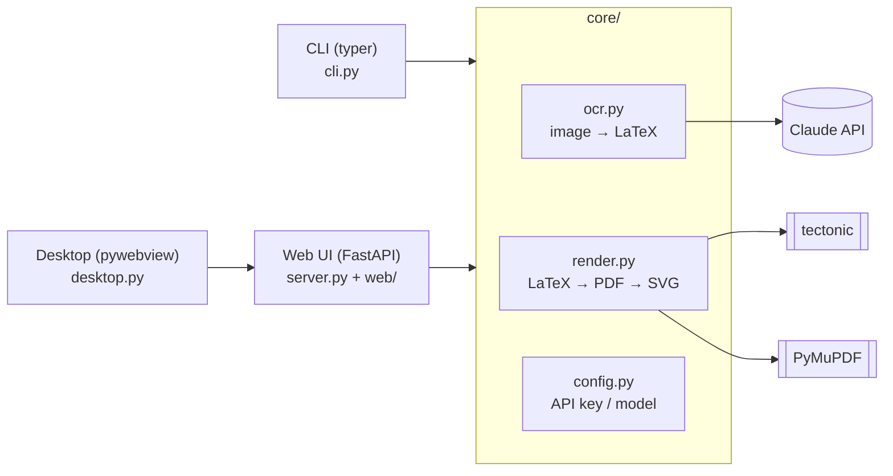

# Architecture & design

🌐 English ｜ [繁體中文](https://github.com/codemee/mathtran/blob/main/docs/zh-TW/architecture.md) ｜ [Back to README](https://github.com/codemee/mathtran/blob/main/README.en.md)

## Overview

Three entry points share one `core`:



The desktop app is just "a pywebview window + a local FastAPI server", sharing the same front end as the web version.

## Modules

| File | Responsibility |
|---|---|
| `core/ocr.py` | Calls the Claude vision API; `clean_latex` strips code fences and `$$` / `\[ \]` |
| `core/render.py` | Wraps the formula in a `standalone` document → tectonic compiles to PDF → PyMuPDF converts to SVG |
| `core/config.py` | API key (env var first, then `~/.mathtran/config.json`) and model name |
| `cli.py` | Subcommands `ocr` / `render` / `convert` / `config` / `serve` / `gui` |
| `server.py` | FastAPI: API plus static front end |
| `desktop.py` | pywebview window, "Save as" API, window icon |
| `web/index.html` | Single-file front end; `web/vendor/` bundles KaTeX (offline) |

## HTTP API

| Method and path | Description |
|---|---|
| `GET /api/health` | Reports whether the API key and tectonic are available |
| `POST /api/config` | Saves the API key |
| `POST /api/ocr` | Upload an image (multipart `file`); returns `{latex}` |
| `POST /api/export/svg`, `/api/export/pdf` | Send `{latex}`; returns the file content |

The server binds to `127.0.0.1` only.

## Rendering pipeline

```mermaid
flowchart LR
    A[Raw LaTeX] --> B{Contains CJK?}
    B -- yes --> C[Wrap in \text{} + load xeCJK]
    B -- no --> D
    C --> D[wrap_latex: add \[ \] if needed]
    D --> E[tectonic compile]
    E --> F[PDF]
    F --> G[PyMuPDF get_svg_image<br/>text_as_path=True]
    G --> H[SVG]
```

- **Automatic math mode**: the formula is wrapped in `\[ \]`; environments that bring their own math mode (`align`, `equation`, …) are used unchanged (see `_STANDALONE_ENV`). `pmatrix` and `aligned` are **not** standalone and need the wrapper.
- **SVG text as outlines**: `text_as_path=True`, so the SVG renders correctly on machines without the fonts.

## Design decisions and pitfalls

| Topic | Decision / reason |
|---|---|
| CJK font by *name* | Selecting a font by file path (e.g. `C:/Windows/Fonts/msjh.ttc`) fails under tectonic; a system font *name* (`Microsoft JhengHei`) works. Override with `MATHTRAN_CJK_FONT` |
| Bare CJK must be in `\text{}` | Math mode does not typeset Chinese; `wrap_cjk_in_text` wraps CJK runs that are not already inside `\text{}` (the KaTeX preview has an equivalent JS version) |
| xeCJK only when needed | Not loaded unless the content has CJK, avoiding an unnecessary font dependency and compile time |
| Desktop export uses "Save as" | pywebview blocks downloads by default (`ALLOW_DOWNLOADS`), so the front end detects `window.pywebview.api.save_file` and saves through `js_api` |
| **Never expose `window` as a public attribute of the `js_api` object** | pywebview recursively walks **every attribute not starting with an underscore** of the `js_api` object. A public `Window` reference makes it walk into native WinForms controls, causing an intermittent whole-process freeze (about 1 in 6 launches). Always use `_window` |
| Window icon | pywebview has no icon parameter on Windows; we set it with `LoadImageW` + `WM_SETICON` |
| Status bar | All progress, results and errors go to the bottom bar; `setErr("")` clears only *errors*, so it never overwrites "Saved: path" |
| Cloud-only OCR | Local pix2tex would pull in PyTorch (1–2 GB when packaged), so it was dropped |

## Development

```bash
uv sync                                  # install dependencies (including dev)
uv run pytest -q                         # tests (they call real tectonic; first run is slow)
uv run mathtran gui                      # launch the desktop app
uv run python packaging/make_icon.py     # regenerate the icon (svg / ico / png)
uv run python packaging/screenshots.py   # regenerate README screenshots (needs a Windows desktop)
```

Two kinds of tests: OCR uses a mock client (no API cost); rendering and export use real tectonic.

## Not done yet

- Packaging as a standalone desktop app with PyInstaller
- Verification on macOS / Linux
- A packaged build must ship the license texts and a way to get the source (the project is GPL-3.0-or-later and depends on the AGPL-3.0 PyMuPDF; see [THIRD_PARTY_NOTICES.md](https://github.com/codemee/mathtran/blob/main/THIRD_PARTY_NOTICES.md))
