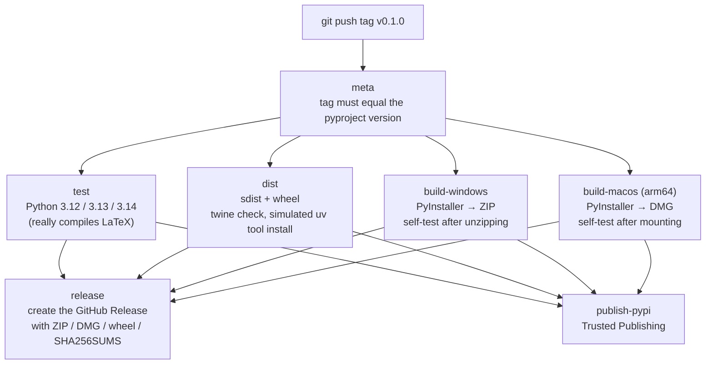

# Release process

🌐 English ｜ [繁體中文](https://github.com/codemee/mathtran/blob/main/docs/zh-TW/releasing.md) ｜ [Back to README](https://github.com/codemee/mathtran/blob/main/README.en.md)

Push a `v*` tag and the cloud tests, packages, and publishes to GitHub Releases and PyPI automatically. The configuration is [`.github/workflows/release.yml`](https://github.com/codemee/mathtran/blob/main/.github/workflows/release.yml).

## Overview



- **Nothing is published unless every test and build passes** (both the GitHub Release and PyPI jobs wait for all of them)
- Running the workflow by hand from the Actions page ("Run workflow") only **builds and tests**; the artifacts stay on that run and **nothing is published**. Use it to try packaging first

## Publishing a new version

1. Change `version` in `pyproject.toml` (for example `0.2.0`)
2. Add a `## [0.2.0] - date` section at the top of [`CHANGELOG.md`](https://github.com/codemee/mathtran/blob/main/CHANGELOG.md) (the Release notes are taken from that section)
3. Commit and push to `main`
4. Tag and push the tag:
   ```bash
   git tag v0.2.0
   git push origin v0.2.0
   ```
5. Watch the Actions page; when it succeeds a new Release appears and PyPI has the new version

> The tag must match the version in `pyproject.toml` (`v0.2.0` ↔ `0.2.0`); otherwise the `meta` job fails and nothing is published.
> A version containing `a` / `b` / `rc` / `dev` (for example `0.2.0rc1`) is marked as a pre-release automatically.

## One-time setup: PyPI Trusted Publishing

Publishing to PyPI uses [Trusted Publishing](https://docs.pypi.org/trusted-publishers/): no password or API token — PyPI trusts "this workflow in this repository". Before the first release you must set it up on PyPI (**only the account owner can do this, on the PyPI website**):

1. Sign in to [pypi.org](https://pypi.org/) and open [Account settings → Publishing](https://pypi.org/manage/account/publishing/)
2. Under "Add a new pending publisher" enter:

   | Field | Value |
   |---|---|
   | PyPI Project Name | `mathtran` |
   | Owner | `codemee` |
   | Repository name | `mathtran` |
   | Workflow name | `release.yml` |
   | Environment name | `pypi` |

3. Save. On the first successful publish PyPI creates the `mathtran` project and binds this publisher to it

If you push a tag before doing this, `publish-pypi` fails **but the GitHub Release is unaffected**. After setting it up, open that run and click "Re-run failed jobs" — **no need to tag again**.

> ⚠️ **A PyPI version number cannot be uploaded twice** (not even after deleting it). If something published is wrong you can only release a new version number, so always check the packaging with a manual run first.

## What is inside the packages

| Item | Windows ZIP | macOS DMG |
|---|---|---|
| Program | `MathTran.exe` + `_internal/` (Python and all dependencies) | `MathTran.app` |
| Tectonic | Bundled (users install nothing) | Bundled (the Apple Silicon / arm64 build) |
| License files | `LICENSE`, `THIRD_PARTY_NOTICES.md`, `TECTONIC_LICENSE.txt`, `SOURCE.txt` | Same, at the root of the DMG |

- The project is GPL-3.0-or-later and depends on the AGPL-3.0 PyMuPDF, so **a distributed package must carry the license texts and say where the source is**. The build script always adds the files above, and `SOURCE.txt` points to the source for that exact tag
- The program looks for Tectonic in this order: the `MATHTRAN_TECTONIC` environment variable → the bundled one → the system `PATH` (see `mathtran.core.render.find_tectonic`)
- To upgrade the bundled Tectonic, change `TECTONIC_VERSION` in the workflow

## Self-test

Cloud machines have no screen, so the packaged program has a "self-test" mode: run it with the environment variable `MATHTRAN_SELFTEST=<result file path>` and it opens no window; instead it starts the built-in server, checks the main features and writes the result as JSON, returning 0 on success and 1 on failure.

What it checks: the server starts, the **bundled** Tectonic is the one in use (not one that happens to be installed), the home page and offline KaTeX assets, the settings API, really compiling SVG / PDF / `.tex`, and a formula with Chinese (marked "skipped", not failed, on a machine without a CJK font).

CI runs it on the **unzipped ZIP** and the **mounted DMG** — i.e. on the file users actually get, not on the build folder.

### Windows: windowed smoke test

The self-test **opens no window**, so it cannot catch problems at the window level. That is how 0.1.0 shipped with a bug: when the ZIP is downloaded with a browser and extracted, every file carries the "downloaded from the Internet" mark (Mark of the Web), so .NET refuses to load pythonnet's `Python.Runtime.dll` and the window crashes on launch (`Failed to resolve Python.Runtime.Loader.Initialize …`). Both CI and my own tests downloaded with `gh` and extracted with PowerShell, and neither of those adds the mark, so it went unnoticed.

The fix is a [`MathTran.exe.config`](https://github.com/codemee/mathtran/blob/main/packaging/MathTran.exe.config) (`loadFromRemoteSources`) next to the exe, which `build_dist.py` puts into the ZIP.

[`packaging/smoke_window.ps1`](https://github.com/codemee/mathtran/blob/main/packaging/smoke_window.ps1) imitates what a user does: extract → **mark every file** (`Zone.Identifier`, ZoneId=3) → really open the window → wait for the window title to become `MathTran <version>` (for example `MathTran 0.1.1`; a title without the version fails, which also confirms the package metadata was bundled); an `Unhandled exception` window, an early exit or a timeout fails it. CI's `build-windows` runs it, and you can run it locally too:

```powershell
pwsh packaging/smoke_window.ps1 -Zip dist\MathTran-<version>-windows-x64.zip           # marked (should pass)
pwsh packaging/smoke_window.ps1 -Zip dist\MathTran-<version>-windows-x64.zip -NoMotw   # control: no mark
```

> The test starts the exe with `CreateProcess` rather than `Start-Process`: when a marked exe is launched through the shell, Windows shows a "publisher could not be verified" dialog and waits for an answer, which would hang the script.

## Building locally

```bash
# needs a tectonic executable; TECTONIC_LICENSE is tectonic's license text (recommended)
TECTONIC_BIN=/path/to/tectonic TECTONIC_LICENSE=/path/to/LICENSE uv run python packaging/build_dist.py
```

Windows (PowerShell):

```powershell
$env:TECTONIC_BIN = "$env:USERPROFILE\scoop\apps\tectonic\current\tectonic.exe"
uv run python packaging/build_dist.py
```

The results are in `dist/`. Self-test:

```powershell
$env:MATHTRAN_SELFTEST = "$PWD\selftest.json"
dist\pyi\MathTran\MathTran.exe     # exit code 0 = passed, result in selftest.json
```

## Known limitations

- **No code signing**: Windows shows a SmartScreen warning; macOS needs the user to allow it manually (the build only ad-hoc signs, so Apple Silicon can run it). Removing the warnings needs paid certificates (Windows Authenticode, Apple Developer ID plus notarization)
- **macOS is packaged for Apple Silicon (arm64) only**; there is no Intel build any more (on an Intel Mac use `uv tool install mathtran`). To bring it back, add `{ os: macos-15-intel, arch: x64, tectonic_target: x86_64-apple-darwin }` to the `build-macos` matrix in `release.yml` and restore that row of the download table in the release notes. `0.1.0` did ship an Intel build (`MathTran-0.1.0-macos-x64.dmg`), which stays on that version's Release
- **The macOS build has not been tried on a real Mac**, only by CI's automatic checks (which open no window, so the window itself, folder pickers and drag and drop are not verified)
- The packages are 100 MB or more (they include the Python runtime, PyMuPDF and Tectonic)
- There is no auto-update; download new versions again (for the PyPI version use `uv tool upgrade mathtran`)
