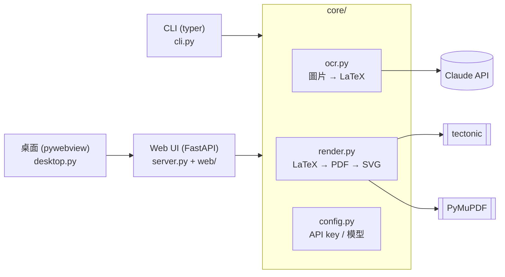
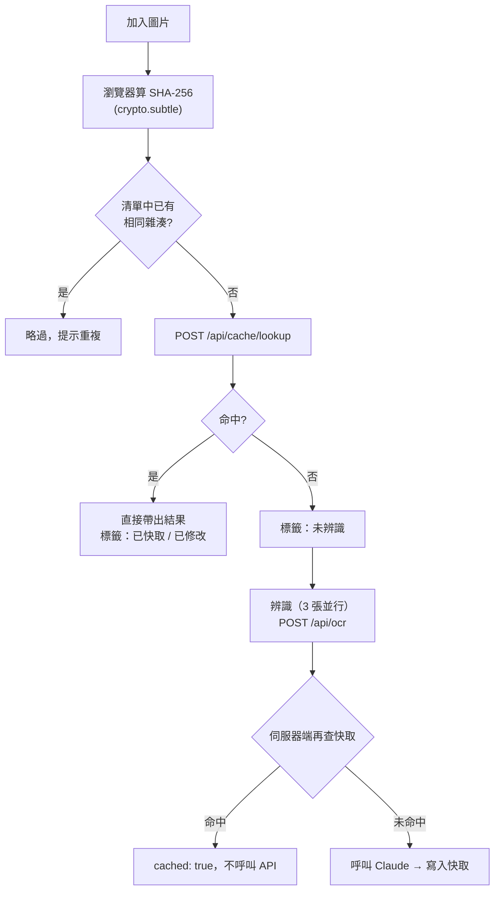
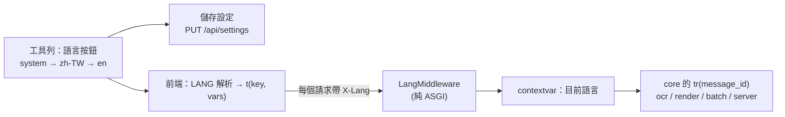

# 架構與設計

🌐 繁體中文 ｜ [English](https://github.com/codemee/mathtran/blob/main/docs/en/architecture.md) ｜ [回到 README](https://github.com/codemee/mathtran/blob/main/README.md)

## 整體架構

三種入口共用同一套 `core`：



桌面 App 只是「pywebview 視窗 + 本機 FastAPI」，與網頁版共用同一份前端。

## 模組

| 檔案 | 職責 |
|---|---|
| `core/ocr.py` | `recognize()`：先查快取、沒有才呼叫 Claude 視覺 API；`clean_latex` 去除程式碼圍欄與 `$$`、`\[ \]` |
| `core/cache.py` | 辨識快取：以圖片 SHA-256 為鍵存於 `~/.mathtran/cache.json`（執行緒鎖 + 原子寫入，檔案損毀時視為空） |
| `core/batch.py` | 批次匯出成 zip：檔名清理與去重（不分大小寫）、個別失敗不中斷、錯誤寫入 `errors.txt` |
| `core/render.py` | 把公式包成 `standalone` 文件 → tectonic 編譯成 PDF → PyMuPDF 轉 SVG |
| `core/config.py` | API key（環境變數優先，其次 `~/.mathtran/config.json`）、模型名稱，以及介面偏好（語言、配色、縮圖、匯出格式）的驗證與保存 |
| `core/i18n.py` | 後端訊息的多語系：`tr()`、語言解析、contextvar |
| `cli.py` | 子指令 `ocr` / `render` / `convert` / `config` / `serve` / `gui` |
| `server.py` | FastAPI：API 與靜態前端 |
| `desktop.py` | pywebview 視窗、另存新檔 / 選資料夾匯出 API、視窗圖示 |
| `web/index.html` | 單檔前端（圖片清單、批次辨識與匯出）；`web/vendor/` 內建 KaTeX（即時預覽）與 MathLive（圖形編輯器），都可離線使用 |

## HTTP API

| 方法與路徑 | 說明 |
|---|---|
| `GET /api/health` | 回報 API key、tectonic 是否可用 |
| `POST /api/config` | 儲存 API key |
| `GET /api/settings` | 回傳 `{lang, theme, thumb, formats}` |
| `PUT /api/settings` | 部分更新介面偏好；任何一項不合法就整批拒絕（400） |
| `POST /api/ocr[?force=true]` | 上傳圖片（multipart `file`），回傳 `{latex, hash, cached}`；`force=true` 忽略快取 |
| `POST /api/cache/lookup` | 傳入 `{hashes: [...]}`，回傳命中的 `{hash: {latex, edited}}` |
| `PUT /api/cache/{sha256}` | 傳入 `{latex}`，存回使用者手動修改的結果（標記 `edited`） |
| `GET /api/cache` | 回傳 `{count, edited, bytes, path}`（筆數、其中手動修改的筆數、檔案大小、位置） |
| `DELETE /api/cache` | 清除全部快取，回傳 `{removed}` |
| `POST /api/cache/remove` | 傳入 `{hashes: [...]}`，只清除指定圖片的快取，回傳 `{removed}` |
| `POST /api/export/svg`、`/pdf`、`/tex` | 傳入 `{latex}`，回傳單一檔案內容（`tex` 是完整可編譯文件，不需要 tectonic） |
| `POST /api/export/batch` | 傳入 `{formats: ["svg","pdf","tex"], items: [{name, latex}]}`，回傳 zip；標頭 `X-Ok-Count`（成功寫入的檔案數）/ `X-Fail-Count`（失敗或略過的項目數） |

服務只綁定 `127.0.0.1`。

## 多圖處理與快取



- **快取鍵是圖片內容的 SHA-256**：改檔名、換資料夾都能命中。瀏覽器與伺服器各自計算，位元組相同則雜湊相同。
- **兩層保護**：前端遇到「已有結果」的項目直接略過（不送請求）；即使送出，伺服器 `recognize()` 也會先查快取。所以 CLI、網頁、桌面共用同一份快取。
- **手動修改會存回快取**（`PUT /api/cache/{hash}`，500 ms 防抖，切換圖片 / 辨識 / 匯出前會立即 flush），標記 `edited`。重新辨識（`force`）會覆蓋它，前端會先 `confirm()`。
- **清除快取**：介面的「快取」對話框可清除全部，或只清除清單內圖片（以雜湊）。清除後前端也把清單內項目的結果歸零（`resetResults`），並取消尚未送出的「手動修改存回」計時器，否則待存的修改會把剛清掉的快取又寫回去。辨識 / 匯出進行中不允許清除（`S.busy`），避免辨識完成又寫回。
- **辨識範圍**（目前檢視 / 勾選 / 全部）只是「對哪些項目執行同一個流程」：沒有結果的才辨識，除非勾了「忽略快取」。
- **失敗處理**：個別失敗只標記該張；錯誤訊息含「API key」時視為致命，整批中止（避免每張都失敗一次）。
- **提示詞版本（`ocr.PROMPT_VERSION`）**：快取每筆記錄 `prompt` 版本。提示詞改版時 +1，舊版本辨識且未被手動修改的結果視為過期（`cache.get/lookup(min_prompt=…)` 不回傳），會重新辨識；`edited=True` 的永遠有效；手動修改不會把 `prompt` 偷偷升級。v1 只轉錄公式、會漏掉圖上的中文，v2 要求連同所有文字以 `\text{…}` 轉錄。
- **批次匯出**：格式可複選（`formats`）。每個項目最多編譯一次（svg 與 pdf 共用同一份 PDF）；`.tex` 不需編譯，所以即使編譯失敗仍會輸出。前端把所有有結果的項目送到 `/api/export/batch`，伺服器依序編譯、打包成 zip。桌面版再由 `js_api.save_zip_to_folder` 讓使用者選資料夾並解壓（`extract_zip`：只取檔名防路徑穿越、不覆蓋既有檔案）；瀏覽器版直接下載 zip。

## 多語系、配色與設定

**語言（繁體中文 / English / 跟隨系統）**



- **前端**：所有文字都在 `I18N` 字典，用 `t(key, vars)` 取；`vars.n === 1` 且有 `key_one` 時用單數說法（英文需要）。靜態 HTML 以 `data-i18n` / `data-i18n-title` / `data-i18n-html` 標記，`applyStatic()` 統一套用；動態內容（徽章、按鈕計數、佔位文字）在 `renderList` / `updateCounts` / `syncRight` 時取詞。
- **狀態列的訊息會隨語言重新翻譯**：`status(key, vars, kind)` 會記住 key；`setStatus(text)` 則是原樣顯示（後端回傳的錯誤、拼接好的訊息）。切換語言時 `applyLanguage()` 重畫全部。
- **「跟隨系統」**：前端用 `navigator.language`（`zh*` → 繁體中文，其餘 → English）；後端（命令列）用 `GetUserDefaultUILanguage()`（Windows）或 `LANG`。
- **後端訊息跟著語言**：前端的每個請求都帶 `X-Lang`（已解析成 `zh-TW` 或 `en`）。`LangMiddleware` 把它存進 contextvar，`core` 裡丟錯誤時用 `tr()` 取當下語言的訊息，所以辨識失敗、編譯失敗、批次的 `errors.txt`、`.tex` 檔頭的註解都是同一種語言。
- **語言的解析順序**（`i18n.current_lang()`）：請求標頭 → 環境變數 `MATHTRAN_LANG` → 介面偏好（設定檔）→ 系統語言。
- 前端靠訊息裡含有「API key」來判斷「沒設定金鑰＝致命錯誤，整批中止」，所以兩種語言的這則訊息都必須包含這個字串（有測試守住）。

**配色（跟隨系統 / 淺色 / 深色）**

- 淺色是**鋼彈 RX-78-2**（白、藍、紅、黃），深色是**新世紀福音戰士**（深紫黑、紫、螢光綠、橘）。只借用配色，沒有使用標誌或圖案；全部是純色，**不使用漸層**（有測試掃描整個畫面的計算後樣式與原始 CSS）。
- 實作：`:root` 定義淺色變數；`@media (prefers-color-scheme: dark)` 在 `:root:not([data-theme="light"])` 下套深色；手動選擇時設定 `<html data-theme="light|dark">` 覆寫系統，`color-scheme` 也一起切換，表單元件與捲軸才會跟著變。
- **文字用的強調色與實心按鈕底色分開**：`--accent`（文字 / 外框）與 `--accent-solid`（實心按鈕、勾選框）。深色配色的淺紫色當文字很清楚，但當實心底色配白字對比不夠，所以另外用較深的紫。
- **對比度有測試**：兩組配色的一般文字、次要文字、強調色、按鈕、各種狀態標籤（含標籤自己的 14% 淡底）都檢查 WCAG 4.5:1。這個檢查抓到過淺色配色的綠 / 青 / 琥珀標籤不足（4.34 / 4.42 / 3.72），已加深。
- 精準預覽是黑字透明底的 SVG，深色配色下會墊白底，否則看不見。

**設定的保存**

- 語言、配色、縮圖大小、匯出格式存在 `~/.mathtran/config.json` 的 `settings`（`GET/PUT /api/settings`；欄位有驗證、不合法整批拒絕、設定檔損毀時退回預設值）。
- **不用 `localStorage`**：桌面版每次啟動的本機埠號都不同，`localStorage` 以「來源（含埠號）」區分，所以重開就會遺失；先前「縮圖大小 / 匯出格式會被記住」在桌面版其實是做不到的。
- 還沒送出的變更會累積（`pendingPatch`）：縮圖滑桿有 400 ms 防抖，若這時又改了別的設定，不能把先前那筆吃掉（有測試抓到過這個 bug）。

## 渲染流程
```mermaid
flowchart LR
    A[LaTeX 原文] --> B{含中日韓字元?}
    B -- 是 --> C[包 \text{} + 載入 xeCJK]
    B -- 否 --> D
    C --> D[wrap_latex：自動補 \[ \]]
    D --> E[tectonic compile]
    E --> F[PDF]
    F --> G[PyMuPDF get_svg_image<br/>text_as_path=True]
    G --> H[SVG]
```

- **自動包數學模式**：以 `\[ \]` 包住公式；`align`、`equation` 等自帶數學模式的環境則原樣使用（見 `_STANDALONE_ENV`）。`pmatrix`、`aligned` **不是**獨立環境，需要外層包裹。
- **SVG 文字轉外框**：`text_as_path=True`，避免對方電腦缺字型。

## 設計決策與踩過的坑

| 主題 | 決定 / 原因 |
|---|---|
| 中文字型要用「名稱」 | tectonic 以檔案路徑指定字型（如 `C:/Windows/Fonts/msjh.ttc`）會失敗；改用系統字型名稱（`Microsoft JhengHei`）可行。可用 `MATHTRAN_CJK_FONT` 覆寫 |
| 裸中文要包 `\text{}` | 數學模式不會畫出中文；`wrap_cjk_in_text` 會把不在 `\text{}` 內的 CJK 連續字元包起來（KaTeX 預覽端有對應的 JS 版本） |
| 只在需要時載入 xeCJK | 內容不含 CJK 就不載入，避免無謂的字型相依與編譯時間 |
| 圖形編輯器（MathLive） | 第一次按「圖形編輯」才用 `<script>` 載入 `vendor/mathlive/`（約 1.1MB，含字型），平常不增加啟動時間。兩種編輯方式共用 `applyEdit(value)`：圖形編輯器只在使用者輸入時（`input` 事件）以 `getValue("latex")` 寫回；換圖或切換模式時用 `setValue(…, {silenceNotifications:true})` 推入，所以單純「看」不會改到內容。中文用 `CJK_RUN` 包成 `\text{}` 後才推入；長公式換行：MathLive 沒有換行選項（超出欄位的部分只隨游標捲動），所以在它的 shadow DOM 裡附加一段樣式（`GFX_WRAP_CSS`）讓最上層各項可折行，欄位高度跟著變高；這依賴它內部的 class 名稱（`.ML__latex` / `.ML__content`），升級 MathLive 時要重新確認；虛擬鍵盤用 `manual` 政策（只在按鍵盤圖示時出現），並關閉按鍵音效 |
| LaTeX 編輯區的語法標色 | 不引入編輯器套件：透明的 `<textarea>` 疊在同尺寸的 `<pre id="hl">` 上，`hlTokens()` 把內容切成指令 / 括號 / 數字 / 文字 / 註解並上色，`hlRender()` 重畫。兩層的字型、邊框、內距、換行、`scrollbar-gutter` 必須完全一致，字才會對齊（`tests/test_highlight.py` 以 node 測標記器與配色對比）；`textarea::selection` 要半透明，否則選取底色會蓋住下層的字；游標旁的括號配對在 `keyup` / `mouseup` / `focus` 時更新 |
| 桌面版匯出走另存新檔對話框 | pywebview 預設擋下載（`ALLOW_DOWNLOADS`），所以前端偵測 `window.pywebview.api.save_file`，改以 `js_api` 儲存 |
| **`js_api` 物件不要放公開屬性參照 window** | pywebview 會遞迴走訪 `js_api` 的**所有不以底線開頭的屬性**；若把 `Window` 物件放在公開屬性，會走進 WinForms 原生控制項，造成約每 6 次啟動 1 次的間歇性整個程式卡死。因此一律用 `_window` |
| 視窗圖示 | pywebview 在 Windows 沒有圖示參數，改以 `LoadImageW` + `WM_SETICON` 設定 |
| 狀態列 | 所有進度、結果、錯誤集中顯示在底部；`setErr("")` 只清除「錯誤」，不會蓋掉「已儲存：路徑」 |
| OCR 只用雲端 | 本機 pix2tex 會帶入 PyTorch（打包 1–2 GB），故捨棄 |
| 阻塞的 API 不能用 `async def` | `/api/ocr` 一開始是 `async def` 卻做阻塞的網路呼叫，會卡住整個事件迴圈，批次並行辨識時連快取查詢都被拖住。改為同步 `def`，由 FastAPI 的執行緒池並行處理 |
| 路由順序 | `POST /api/export/batch` 必須註冊在 `/api/export/{fmt}` **之前**，否則 `batch` 會被當成格式而回 404 |
| 圖片清單用「指定高度」而非 `aspect-ratio` | 在 CSS Grid 裡，`aspect-ratio` 不會被列高計算採用，卡片會互相重疊（下一列蓋住上一列的圖）。改用 `height: calc(var(--thumb) * .75)` |
| 縮圖用 `object-fit: contain` | 完整顯示整張圖，不裁切；勾選框與標籤以絕對定位疊在圖片區上，檔名是圖片下方獨立的說明列（不蓋住圖，過長時用 JS 做「中間省略」以保留結尾差異） |
| 預覽不能用 flex 置中 | `display:flex; justify-content:center` 在內容比容器寬時，左側會超出可捲動範圍而被切掉、捲不到。預覽區改用一般區塊 + `text-align:center` |
| 判斷「公式有沒有太寬」不能量 `.katex` | 顯示模式下 `.katex` 寬度永遠等於容器寬度（內容是溢出去的），量不到真實寬度；也不能把 `scrollWidth` 當內容寬度（沒溢出時它等於 `clientWidth`，會誤判成溢出）。`fitPreview()` 只在 `scrollWidth > clientWidth` 時縮小，並重複檢查直到不再溢出（有下限 `PV_MIN_SCALE`） |
| 即時 / 精準預覽的狀態 | `S.pv` 為 `live` 或 `acc`；精準結果存在 `item.acc = {latex, url}`，只有 `latex` 仍相同才有效，所以切換不重新編譯，修改內容後自動回到即時 |
| 測試與快取隔離 | `tests/conftest.py` 自動把 `config.CONFIG_PATH` 指到暫存資料夾，避免測試污染你真正的快取；`cache_path()` 每次呼叫才計算路徑 |
| PyMuPDF 要限定 1.x（`pymupdf>=1.28,<2`） | 2.x 把 `pymupdf-layout`、`pymupdf4llm`、`onnxruntime`、`numpy` 等一整串東西列為必要相依。後果：安裝包大幅變大（ZIP 117 MB → 65 MB）、`onnxruntime` 沒有 macOS Intel 的安裝檔（雲端的 Intel 打包因此失敗）、`pymupdf-layout` / `pymupdf4llm` 在 PyPI 上沒有宣告授權。我們只用最基本的功能（開 PDF、轉 SVG、畫圖示），1.x 完全夠用 |
| `print` 中文在 CI 的 Windows 會當掉 | CI 的 Windows 主控台預設編碼是 cp1252，印中文會 `UnicodeEncodeError`（打包其實成功了，卻在最後一行失敗）。建置腳本一開始就把 stdout / stderr 改成 UTF-8 |
| 標題列的版本號（`mathtran.__version__`） | 版本號只有 `pyproject.toml` 一個來源，執行時用 `importlib.metadata` 從「已安裝套件的資訊」讀。**PyInstaller 不會自動帶這份資訊**，要在 `mathtran.spec` 用 `copy_metadata("mathtran")`，否則打包版讀不到、標題會少版本號；自我檢查（`version` / `window_title_has_version`）與煙霧測試（標題必須是 `MathTran <版本>`）都會抓這件事。視窗標題同時是「找視窗」用的字串（設定圖示、截圖），所以統一用 `APP_TITLE` 一個常數 |
| 瀏覽器下載的 ZIP 解壓縮後 .NET 拒絕載入元件 | 檔案帶「來自網際網路」標記（Mark of the Web）時，.NET Framework 預設拒絕載入，pywebview 的 pythonnet 因此失敗。解法：附 `MathTran.exe.config`（`loadFromRemoteSources`）。**測試時用 `gh` 下載、PowerShell 解壓縮都不會帶標記，所以一開始完全沒發現**；現在有 `packaging/smoke_window.ps1` 專門模擬這個情境 |
| 帶標記的 exe 不能用 `Start-Process` 啟動 | 經過 shell 啟動會跳出「無法驗證發行者」對話框並卡住；測試改用 `CreateProcess`（`UseShellExecute = false`） |
| `tr()` 的第一個參數要 positional-only | 訊息的佔位符可能叫 `key` / `name`，若 `tr(key, **kw)` 的參數也叫 `key` 就會撞名（`got multiple values for argument`）。改成 `tr(message_id, /, **kw)` |
| 純 ASGI middleware | 用 `BaseHTTPMiddleware` 時 contextvar 在 FastAPI 於執行緒池跑的同步端點裡不一定可靠；寫成純 ASGI（`__call__(scope, receive, send)`）才穩，並有「24 個中英文請求同時送出，訊息不互相混到」的測試 |
| 螢幕擷取工具要防「拍到別的視窗」 | `packaging/screenshots.py` 抓的是螢幕畫面：視窗被蓋住就會拍到其他內容（可能含隱私）。因此擷取前會設為最上層並確認為前景視窗，做不到就報錯、不寫檔 |

## 開發

```bash
uv sync                                  # 安裝相依（含 dev）
uv run pytest -q                         # 測試（含實際呼叫 tectonic，首次較慢）
uv run mathtran gui                      # 啟動桌面版
uv run python packaging/make_icon.py     # 重新產生圖示（svg / ico / icns / png）
uv run python packaging/screenshots.py   # 重新產生 README 截圖（需 Windows 桌面環境）
TECTONIC_BIN=<路徑> uv run python packaging/build_dist.py   # 在本機打包安裝包（Windows → ZIP、macOS → DMG）
```

測試分兩類：OCR 以 mock client 測試（不花 API 費用）；渲染與匯出使用真的 tectonic。

## 發布與打包

發布流程（打標籤 → 雲端測試、打包、發布到 GitHub Release 與 PyPI）見 [發布流程](https://github.com/codemee/mathtran/blob/main/docs/zh-TW/releasing.md)。

## 尚未完成

- macOS / Linux 的實機驗證（macOS 安裝包目前只由雲端打包並做自動檢查）
- 程式碼簽章與公證（Windows Authenticode、Apple Developer ID）：需要付費憑證，安裝包目前沒有簽章
