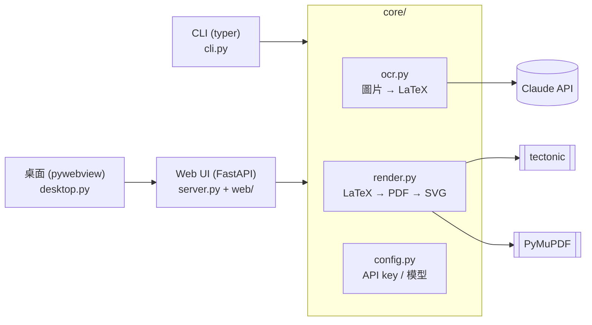

# 架構與設計

🌐 繁體中文 ｜ [English](https://github.com/codemee/mathtran/blob/main/docs/en/architecture.md) ｜ [回到 README](https://github.com/codemee/mathtran/blob/main/README.md)

## 整體架構

三種入口共用同一套 `core`：



桌面 App 只是「pywebview 視窗 + 本機 FastAPI」，與網頁版共用同一份前端。

## 模組

| 檔案 | 職責 |
|---|---|
| `core/ocr.py` | 呼叫 Claude 視覺 API；`clean_latex` 去除程式碼圍欄與 `$$`、`\[ \]` |
| `core/render.py` | 把公式包成 `standalone` 文件 → tectonic 編譯成 PDF → PyMuPDF 轉 SVG |
| `core/config.py` | API key（環境變數優先，其次 `~/.mathtran/config.json`）與模型名稱 |
| `cli.py` | 子指令 `ocr` / `render` / `convert` / `config` / `serve` / `gui` |
| `server.py` | FastAPI：API 與靜態前端 |
| `desktop.py` | pywebview 視窗、另存新檔 API、視窗圖示 |
| `web/index.html` | 單檔前端；`web/vendor/` 內建 KaTeX（離線） |

## HTTP API

| 方法與路徑 | 說明 |
|---|---|
| `GET /api/health` | 回報 API key、tectonic 是否可用 |
| `POST /api/config` | 儲存 API key |
| `POST /api/ocr` | 上傳圖片（multipart `file`），回傳 `{latex}` |
| `POST /api/export/svg`、`/api/export/pdf` | 傳入 `{latex}`，回傳檔案內容 |

服務只綁定 `127.0.0.1`。

## 渲染流程

```mermaid
flowchart LR
    A[LaTeX 原文] --> B{含中日韓字元?}
    B -- 是 --> C[包 \text{} + 載入 xeCJK]
    B -- 否 --> D
    C --> D[wrap_latex：自動補 \[ \]]
    D --> E[tectonic compile]
    E --> F[PDF]
    F --> G[PyMuPDF get_svg_image<br/>text_as_path=True]
    G --> H[SVG]
```

- **自動包數學模式**：以 `\[ \]` 包住公式；`align`、`equation` 等自帶數學模式的環境則原樣使用（見 `_STANDALONE_ENV`）。`pmatrix`、`aligned` **不是**獨立環境，需要外層包裹。
- **SVG 文字轉外框**：`text_as_path=True`，避免對方電腦缺字型。

## 設計決策與踩過的坑

| 主題 | 決定 / 原因 |
|---|---|
| 中文字型要用「名稱」 | tectonic 以檔案路徑指定字型（如 `C:/Windows/Fonts/msjh.ttc`）會失敗；改用系統字型名稱（`Microsoft JhengHei`）可行。可用 `MATHTRAN_CJK_FONT` 覆寫 |
| 裸中文要包 `\text{}` | 數學模式不會畫出中文；`wrap_cjk_in_text` 會把不在 `\text{}` 內的 CJK 連續字元包起來（KaTeX 預覽端有對應的 JS 版本） |
| 只在需要時載入 xeCJK | 內容不含 CJK 就不載入，避免無謂的字型相依與編譯時間 |
| 桌面版匯出走另存新檔對話框 | pywebview 預設擋下載（`ALLOW_DOWNLOADS`），所以前端偵測 `window.pywebview.api.save_file`，改以 `js_api` 儲存 |
| **`js_api` 物件不要放公開屬性參照 window** | pywebview 會遞迴走訪 `js_api` 的**所有不以底線開頭的屬性**；若把 `Window` 物件放在公開屬性，會走進 WinForms 原生控制項，造成約每 6 次啟動 1 次的間歇性整個程式卡死。因此一律用 `_window` |
| 視窗圖示 | pywebview 在 Windows 沒有圖示參數，改以 `LoadImageW` + `WM_SETICON` 設定 |
| 狀態列 | 所有進度、結果、錯誤集中顯示在底部；`setErr("")` 只清除「錯誤」，不會蓋掉「已儲存：路徑」 |
| OCR 只用雲端 | 本機 pix2tex 會帶入 PyTorch（打包 1–2 GB），故捨棄 |

## 開發

```bash
uv sync                                  # 安裝相依（含 dev）
uv run pytest -q                         # 測試（含實際呼叫 tectonic，首次較慢）
uv run mathtran gui                      # 啟動桌面版
uv run python packaging/make_icon.py     # 重新產生圖示（svg / ico / png）
uv run python packaging/screenshots.py   # 重新產生 README 截圖（需 Windows 桌面環境）
```

測試分兩類：OCR 以 mock client 測試（不花 API 費用）；渲染與匯出使用真的 tectonic。

## 尚未完成

- PyInstaller 打包成免安裝的桌面 App
- macOS / Linux 的實機驗證
- 打包時要隨附授權文件與原始碼取得方式（專案為 GPL-3.0-or-later，且相依 AGPL-3.0 的 PyMuPDF，見 [THIRD_PARTY_NOTICES.md](https://github.com/codemee/mathtran/blob/main/THIRD_PARTY_NOTICES.md)）
