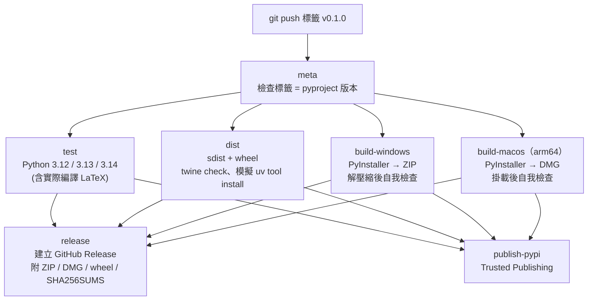

# 發布流程

🌐 繁體中文 ｜ [English](https://github.com/codemee/mathtran/blob/main/docs/en/releasing.md) ｜ [回到 README](https://github.com/codemee/mathtran/blob/main/README.md)

打一個 `v*` 標籤，雲端就會自動測試、打包，並發布到 GitHub Release 與 PyPI。設定檔：[`.github/workflows/release.yml`](https://github.com/codemee/mathtran/blob/main/.github/workflows/release.yml)。

## 整體流程



- **全部測試與打包都通過才會發布**（GitHub Release 與 PyPI 兩個工作都要等前面全部成功）
- 在 GitHub 的 Actions 頁面手動執行（Run workflow）只會「建置與測試」，成品留在該次執行的 Artifacts，**不會發布任何東西**；想先試打包時用這個

## 發布新版本的步驟

1. 修改 `pyproject.toml` 的 `version`（例如 `0.2.0`）
2. 在 [`CHANGELOG.md`](https://github.com/codemee/mathtran/blob/main/CHANGELOG.md) 最上面新增 `## [0.2.0] - 日期` 段落（Release 說明就是取這一段）
3. 提交並推送到 `main`
4. 打標籤並推送：
   ```bash
   git tag v0.2.0
   git push origin v0.2.0
   ```
5. 到 GitHub 的 Actions 頁面看進度；成功後會出現新的 Release，PyPI 也會有新版本

> 標籤必須和 `pyproject.toml` 的版本一致（`v0.2.0` ↔ `0.2.0`），不一致時 `meta` 工作會直接失敗，什麼都不會發布。
> 版本號含 `a` / `b` / `rc` / `dev`（例如 `0.2.0rc1`）會自動標成 pre-release。

## 一次性設定：PyPI Trusted Publishing

發布到 PyPI 使用 [Trusted Publishing](https://docs.pypi.org/trusted-publishers/)：不需要密碼或 API token，PyPI 直接信任「這個 repo 的這個工作流程」。第一次發布前，必須先在 PyPI 設定（**只能由帳號擁有者在 PyPI 網站上操作**）：

1. 登入 [pypi.org](https://pypi.org/)，開啟 [Account settings → Publishing](https://pypi.org/manage/account/publishing/)
2. 在「Add a new pending publisher」填入：

   | 欄位 | 值 |
   |---|---|
   | PyPI Project Name | `mathtran` |
   | Owner | `codemee` |
   | Repository name | `mathtran` |
   | Workflow name | `release.yml` |
   | Environment name | `pypi` |

3. 儲存。之後第一次成功發布時，PyPI 會自動建立 `mathtran` 專案並把這個發布者綁上去

如果還沒設定就推了標籤：`publish-pypi` 會失敗，**但 GitHub Release 不受影響**。設定好之後，到那次執行的頁面按「Re-run failed jobs」即可，**不需要重新打標籤**。

> ⚠️ **PyPI 的版本號一旦發布就不能重傳**（連刪除後也不行）。發現發布的內容有問題時，只能發布新的版本號，所以發布前務必先用手動執行確認打包沒問題。

## 安裝包裡有什麼

| 項目 | Windows ZIP | macOS DMG |
|---|---|---|
| 程式 | `MathTran.exe` + `_internal/`（Python 與所有相依套件） | `MathTran.app` |
| Tectonic | 附帶（使用者不必另外安裝） | 附帶（Apple Silicon / arm64 版） |
| 授權文件 | `LICENSE`、`THIRD_PARTY_NOTICES.md`、`TECTONIC_LICENSE.txt`、`SOURCE.txt` | 同左，放在 DMG 根目錄 |

- 專案是 GPL-3.0-or-later，且相依 AGPL-3.0 的 PyMuPDF，**散布安裝包時必須附上授權全文並說明原始碼在哪裡**，所以建置腳本一定會放入上面的文件，其中 `SOURCE.txt` 指向該版本標籤對應的原始碼
- 程式找 Tectonic 的順序：環境變數 `MATHTRAN_TECTONIC` → 安裝包附帶的 → 系統 `PATH`（見 `mathtran.core.render.find_tectonic`）
- 要升級附帶的 Tectonic 版本，修改工作流程裡的 `TECTONIC_VERSION`

## 自我檢查

雲端的機器沒有螢幕，所以打包出來的程式有一個「自我檢查」模式：設定環境變數 `MATHTRAN_SELFTEST=<結果檔路徑>` 再執行，程式不會開視窗，而是啟動內建伺服器、檢查主要功能，把結果寫成 JSON，通過回傳 0、失敗回傳 1。

檢查項目：伺服器啟動、使用的是**安裝包附帶**的 Tectonic（不是系統上剛好有裝）、首頁與離線 KaTeX 等網頁資源、設定 API、實際編譯 SVG / PDF / `.tex`、含中文的公式（機器上沒有中文字型時標記為「略過」，不算失敗）。

雲端會對「解壓縮後的 ZIP」和「掛載後的 DMG」各做一次，也就是檢查**使用者實際拿到的檔案**，而不是建置資料夾。

### Windows：開視窗煙霧測試

自我檢查**不會開視窗**，所以抓不到「視窗那一層」的問題。0.1.0 就因此漏掉一個 bug：用瀏覽器下載 ZIP、解壓縮後，每個檔案都帶「來自網際網路」標記（Mark of the Web），.NET 因此拒絕載入 pythonnet 的 `Python.Runtime.dll`，視窗一開就當掉（`Failed to resolve Python.Runtime.Loader.Initialize …`）。雲端和我自己的測試都是用 `gh` 下載、用 PowerShell 解壓縮，這兩種做法都**不會**帶標記，所以沒遇到。

修法是在 exe 旁邊附一個 [`MathTran.exe.config`](https://github.com/codemee/mathtran/blob/main/packaging/MathTran.exe.config)（`loadFromRemoteSources`），由 `build_dist.py` 放進 ZIP。

[`packaging/smoke_window.ps1`](https://github.com/codemee/mathtran/blob/main/packaging/smoke_window.ps1) 會模擬使用者的做法：解壓縮 → **替每個檔案加上標記**（`Zone.Identifier`，ZoneId=3）→ 真的開視窗 → 等視窗標題變成 `MathTran <版本號>`（例如 `MathTran 0.1.1`，沒有版本號就算失敗，這樣也順便確認打包時有帶進套件的版本資訊）；出現 `Unhandled exception` 視窗、提早結束或逾時就失敗。雲端的 `build-windows` 會執行它；本機也可以跑：

```powershell
pwsh packaging/smoke_window.ps1 -Zip dist\MathTran-<版本>-windows-x64.zip           # 帶標記（應該通過）
pwsh packaging/smoke_window.ps1 -Zip dist\MathTran-<版本>-windows-x64.zip -NoMotw   # 對照組：不帶標記
```

> 這個測試用 `CreateProcess` 啟動 exe，而不是 `Start-Process`：帶標記的 exe 經過 shell 啟動時，Windows 會跳出「無法驗證發行者」的對話框並一直等待，腳本就卡住了。

## 在本機打包

```bash
# 需要 tectonic 執行檔；TECTONIC_LICENSE 是 tectonic 的授權全文（建議提供）
TECTONIC_BIN=/path/to/tectonic TECTONIC_LICENSE=/path/to/LICENSE uv run python packaging/build_dist.py
```

Windows（PowerShell）：

```powershell
$env:TECTONIC_BIN = "$env:USERPROFILE\scoop\apps\tectonic\current\tectonic.exe"
uv run python packaging/build_dist.py
```

成品在 `dist/`。自我檢查：

```powershell
$env:MATHTRAN_SELFTEST = "$PWD\selftest.json"
dist\pyi\MathTran\MathTran.exe     # 結束代碼 0 = 通過，結果在 selftest.json
```

## 已知限制

- **沒有程式碼簽章**：Windows 會出現 SmartScreen 警告；macOS 需要使用者手動允許（建置時只做 ad-hoc 簽章，讓 Apple Silicon 能執行）。要消除警告需要付費憑證（Windows Authenticode、Apple Developer ID 與公證）
- **macOS 只打包 Apple Silicon（arm64）**，不再提供 Intel 版（Intel Mac 請用 `uv tool install mathtran`）。要加回來：在 `release.yml` 的 `build-macos` 矩陣加一行 `{ os: macos-15-intel, arch: x64, tectonic_target: x86_64-apple-darwin }`，並把發布說明的下載表加回那一列。`0.1.0` 當時有同時發布 Intel 版（`MathTran-0.1.0-macos-x64.dmg`），那個檔案仍留在該版的 Release 裡
- **macOS 版沒有在實體 Mac 上測試過**，只有雲端的自動檢查（它不會開視窗，所以視窗本身、資料夾選擇、拖曳等互動沒有被驗證）
- 安裝包約 100 MB 以上（含 Python 執行環境、PyMuPDF 與 Tectonic）
- 安裝包沒有自動更新機制；新版本請重新下載（PyPI 版用 `uv tool upgrade mathtran`）
